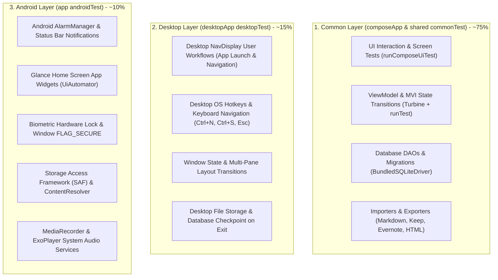
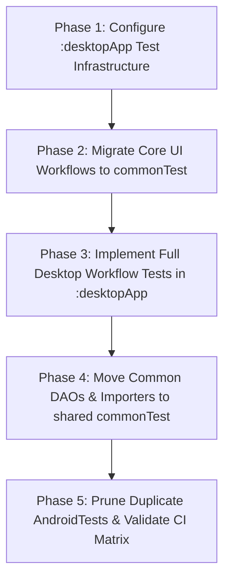

# KMP Test Strategy & Refactoring Plan: Common, AndroidTest, and Desktop Test Parity

## 1. Executive Summary & Context

NotallyX has evolved from a single-target Android application into a modular **Kotlin Multiplatform (KMP)** project targeting both **Android** and **Desktop (JVM)**. The current project architecture consists of:
- [`:shared`](file:///home/user/AndroidStudioProjects/NotallyX/shared/build.gradle.kts): KMP domain, models, Room 3 database, DAO layer, formatters, and importers.
- [`:composeApp`](file:///home/user/AndroidStudioProjects/NotallyX/composeApp/build.gradle.kts): KMP Compose UI module hosting shared presentation logic, routes, themes, components, and Navigation 3 graph.
- [`:app`](file:///home/user/AndroidStudioProjects/NotallyX/app/build.gradle.kts): Android application host container, activities, background services, Glance app widgets, and system integrations.
- [`:desktopApp`](file:///home/user/AndroidStudioProjects/NotallyX/desktopApp/build.gradle.kts): Desktop application host entry point (`Main.kt`) running Compose Multiplatform window and [`DesktopNavDisplay`](file:///home/user/AndroidStudioProjects/NotallyX/desktopApp/src/desktopMain/kotlin/com/philkes/notallyx/desktop/DesktopNavDisplay.kt).
- [`:test-lib`](file:///home/user/AndroidStudioProjects/NotallyX/test-lib/build.gradle.kts): Shared Android testing fixtures, rules, and fakes.

### Problem Statement
Despite the KMP migration, the existing test architecture suffers from significant cross-platform gaps and inefficiencies:
1. **Monolithic `androidTest` Bottleneck**: Over 10,000 lines of instrumented UI tests in `app/src/androidTest` ([`EditRouteTest.kt`](file:///home/user/AndroidStudioProjects/NotallyX/app/src/androidTest/kotlin/com/philkes/notallyx/activity/edit/EditRouteTest.kt), [`EditListRouteTest.kt`](file:///home/user/AndroidStudioProjects/NotallyX/app/src/androidTest/kotlin/com/philkes/notallyx/activity/edit/EditListRouteTest.kt), [`MainActivityTest.kt`](file:///home/user/AndroidStudioProjects/NotallyX/app/src/androidTest/kotlin/com/philkes/notallyx/activity/main/MainActivityTest.kt), [`SettingsRouteTest.kt`](file:///home/user/AndroidStudioProjects/NotallyX/app/src/androidTest/kotlin/com/philkes/notallyx/activity/main/routes/SettingsRouteTest.kt)) still test pure Compose UI interactions (text entry, button clicks, color picking, undo/redo, checklist reordering) bound to Android `ActivityScenario.launch(MainActivity::class.java)` and `context.getString(R.string...)`.
2. **Missing Desktop Test Coverage**: While desktop has its own top-level app entry point ([`DesktopNavDisplay.kt`](file:///home/user/AndroidStudioProjects/NotallyX/desktopApp/src/desktopMain/kotlin/com/philkes/notallyx/desktop/DesktopNavDisplay.kt)), `:desktopApp` currently has **zero automated tests**. Desktop user workflows are completely unverified by CI.
3. **Misplaced Platform-Agnostic Tests**: DAOs ([`CommonDaoTest.kt`](file:///home/user/AndroidStudioProjects/NotallyX/shared/src/androidHostTest/kotlin/com/philkes/notallyx/data/dao/CommonDaoTest.kt)), importers, and pure Kotlin editor logic reside in `androidHostTest` under Robolectric rather than running in `commonTest` on standard JVM SQLite.

### Guiding North Star: "Test Once in Common, Validate Edges on Target"
Per [docs/kmp-test-strategy.md](file:///home/user/AndroidStudioProjects/NotallyX/docs/kmp-test-strategy.md):
- **Common UI & Domain (70–80%)**: All shared UI routes, user interactions, ViewModel MVI state flows, and business logic belong in `commonTest` using `runComposeUiTest` / `compose.uiTest`. They run headlessly on the JVM in seconds without an emulator, and execute identically for Android.
- **Desktop Target (`desktopTest`)**: Tests desktop application workflows ([`DesktopNavDisplay`](file:///home/user/AndroidStudioProjects/NotallyX/desktopApp/src/desktopMain/kotlin/com/philkes/notallyx/desktop/DesktopNavDisplay.kt)), window lifecycles, keyboard shortcuts (Ctrl+S, Ctrl+N, Esc), native file pickers, and OS integrations.
- **Android Target (`androidTest`)**: Strictly reserved for Android OS system services (Notifications, Alarms, App Widgets, Biometric prompts, `FLAG_SECURE`, SAF ContentResolvers, and SQLCipher hardware security).

---

## 2. Target Test Pyramid & Source Set Placement Matrix



### Source Set Allocation Summary

| Module | Source Set | Test Tooling | Target Responsibilities |
|---|---|---|---|
| `:composeApp` | `src/commonTest` | `runComposeUiTest`, `kotlin.test`, Coroutines Test | **All shared UI routes & screens**: `NotesRoute`, `EditNoteRoute`, `EditListRoute`, `LabelsRoute`, `SearchRoute`, `SettingsRoute`, `ArchivedRoute`, `DeletedRoute`. Semantics assertions, text editing, color selection, drag/reorder, dialogs. |
| `:composeApp` | `src/androidHostTest` | Robolectric, MockK, Turbine | Android-specific ViewModel extensions (`koinViewModel()`), Android context adapters, Android-specific formatters. |
| `:desktopApp` | `src/desktopTest` | `runComposeUiTest`, JUnit 4, Desktop Koin | **Full Desktop User Workflows**: Launching `DesktopNavDisplay`, navigation drawer switching, two-pane list-detail flows, keyboard shortcuts, window lifecycle, and database checkpointing. |
| `:shared` | `src/commonTest` | `kotlin.test`, `BundledSQLiteDriver`, Coroutines Test | Common DAOs (`BaseNoteDao`, `LabelDao`), Room in-memory DB operations, Converters, note splitting/repairing, Markdown parsing/exporting. |
| `:shared` | `src/androidHostTest` | Robolectric, Android Room SQLite Wrapper | Legacy SQLCipher migrations, Tink encrypted SharedPreferences, Android-specific file migrations. |
| `:shared` | `src/desktopTest` | `BundledSQLiteDriver`, JVM File IO | Desktop SQLite driver factory, file path resolution across OS distributions. |
| `:app` | `src/androidTest` | `AndroidJUnit4`, `createEmptyComposeRule`, UiAutomator, Espresso | **Android OS Hardware & Services**: `RemindersActivityTest` (Alarms, Notifications), `WidgetTest` (Glance), `LockedActivityTest` (Biometrics, `FLAG_SECURE`), `ErrorActivityTest`, SAF file pickers. |
| `:app` | `src/screenshotTestDebug` & `src/test` | AGP Screenshot Engine, Roborazzi | Isolated Composable visual edge cases, theme variations (Light, Dark, OLED), typography, and reference image comparisons. |

---

## 3. Comprehensive Audit of Existing AndroidTests vs Desktop Parity

### 3.1 [`EditRouteTest.kt`](file:///home/user/AndroidStudioProjects/NotallyX/app/src/androidTest/kotlin/com/philkes/notallyx/activity/edit/EditRouteTest.kt) (2,884 lines)

| Test Method in `EditRouteTest` | Current Implementation | Classification | Action & Target Destination |
|---|---|---|---|
| `createAndEditTextNote()` | Launches `MainActivity`, clicks "Take note", enters Title/Body, pins note, changes color to Coral, adds label, exits back, verifies note in list. | **Common UI Workflow** | **Move to `composeApp/src/commonTest`** (`EditRouteCommonTest.kt`). Equivalent desktop workflow in `desktopApp/src/desktopTest` (`DesktopEditorWorkflowTest.kt`). |
| `textFormatting()` | Selects text ranges, toggles Bold, Italic, Strikethrough, Monospace, inserts hyperlink dialog, clears formatting. | **Common UI Workflow** | **Move to `composeApp/src/commonTest`** (`EditRouteCommonTest.kt`). Visual spans verified in `screenshotTestDebug`. |
| `undoAndRedo()` | Types characters, presses Undo/Redo in top bar, asserts text state restoration. | **Common UI Workflow** | **Move to `composeApp/src/commonTest`** (`EditRouteCommonTest.kt`). Add desktop shortcut verification (Ctrl+Z / Ctrl+Y) in `desktopTest`. |
| `changeNoteColor()` | Opens color palette dialog, selects swatches, custom HEX input, sets default note color. | **Common UI Workflow** | **Move to `composeApp/src/commonTest`** (`EditRouteCommonTest.kt`). |
| `search()` | Searches keyword within note body, navigates occurrences via next/previous buttons. | **Common UI Workflow** | **Move to `composeApp/src/commonTest`** (`EditRouteCommonTest.kt`). |
| `autoSaveAndUnsavedChanges()` | Auto-saves note on idle timer or back navigation; shows unsaved confirmation dialog. | **Common UI Workflow** | **Move to `composeApp/src/commonTest`** (`EditRouteCommonTest.kt`). |
| `insertAndClickInternalNoteLink()` | Inserts `note://<id>` link, clicks link, verifies target note opens in editor. | **Common UI Workflow** | **Move to `composeApp/src/commonTest`** (`EditRouteCommonTest.kt`). |
| `selectAndAddLabelsForNote()` | Opens labels bottom sheet/dialog, toggles label checkboxes, creates new label inline. | **Common UI Workflow** | **Move to `composeApp/src/commonTest`** (`EditRouteCommonTest.kt`). |
| `reminders()` | Opens DatePicker and TimePicker dialogs, sets recurring alarm rule. | **Common UI / Target Edge** | Common dialog flow in `commonTest`; Alarm scheduling stays in `androidTest`. |
| `addAttachments()`, `openGenericFileAttachment()` | Storage Access Framework (SAF) file picker intent (`ACTION_OPEN_DOCUMENT`). | **Target Edge (Android)** | Keep in `app/src/androidTest`. Create desktop counterpart with `DesktopFilePicker` / JVM File Dialog in `desktopTest`. |
| `export()` | Multi-format export (TXT, MD, JSON, HTML, PDF) via SAF `ACTION_CREATE_DOCUMENT`. | **Target Edge (Android)** | Keep SAF in `androidTest`. Common export generation in `commonTest`; desktop file write in `desktopTest`. |
| `playAndControlAudioAttachment()`, `recordAudioControls()` | MediaRecorder and ExoPlayer Android foreground service. | **Target Edge (Android)** | Keep in `app/src/androidTest`. |

---

### 3.2 [`EditListRouteTest.kt`](file:///home/user/AndroidStudioProjects/NotallyX/app/src/androidTest/kotlin/com/philkes/notallyx/activity/edit/EditListRouteTest.kt) (1,878 lines)

| Test Method in `EditListRouteTest` | Current Implementation | Classification | Action & Target Destination |
|---|---|---|---|
| `listItems()` | Adds checklist items, checks/unchecks items, deletes item via swipe or delete icon. | **Common UI Workflow** | **Move to `composeApp/src/commonTest`** (`EditListRouteCommonTest.kt`). |
| `moreListOptionsCheckAndClearAll()` | Opens overflow menu: "Check all", "Uncheck all", "Delete checked items". | **Common UI Workflow** | **Move to `composeApp/src/commonTest`** (`EditListRouteCommonTest.kt`). |
| `dragAndDropAndSwipe()` | Simulates drag-and-drop reordering and swipe gestures for parent/child indentation. | **Common UI Workflow** | **Move to `composeApp/src/commonTest`** (`EditListRouteCommonTest.kt`) using Compose touch/pointer semantics. |
| `dragParentWithChildrenDown()` | Reorders parent checklist item and asserts child items remain nested underneath. | **Common UI Workflow** | **Move to `composeApp/src/commonTest`** (`EditListRouteCommonTest.kt`). |
| `multiStepUndoAndRedoDeepStack()` | Exercises deep 10+ step undo/redo stack across checklist modifications. | **Common UI Workflow** | **Move to `composeApp/src/commonTest`** (`EditListRouteCommonTest.kt`). |
| `undoAndRedoIndentationAndReordering()` | Verifies undo/redo restoration of indentation hierarchy and item order. | **Common UI Workflow** | **Move to `composeApp/src/commonTest`** (`EditListRouteCommonTest.kt`). |
| `noteStructureConversionFidelity()` | Converts Checklist note to Text note and verifies Markdown indentation fidelity (`- [ ]`). | **Common UI Workflow** | **Move to `composeApp/src/commonTest`** (`EditListRouteCommonTest.kt`). |
| `listItemSort()` | Sorts list items alphabetically or by completed status. | **Common UI Workflow** | **Move to `composeApp/src/commonTest`** (`EditListRouteCommonTest.kt`). |

---

### 3.3 [`MainActivityTest.kt`](file:///home/user/AndroidStudioProjects/NotallyX/app/src/androidTest/kotlin/com/philkes/notallyx/activity/main/MainActivityTest.kt) (1,026 lines)

| Test Method in `MainActivityTest` | Current Implementation | Classification | Action & Target Destination |
|---|---|---|---|
| `searchNotes()` | Enters search queries in top bar, asserts filtered grid results across notes and folders. | **Common UI Workflow** | **Move to `composeApp/src/commonTest`** (`NotesRouteCommonTest.kt` / `SearchRouteCommonTest.kt`). |
| `sortNotesOrderDialog()` | Opens Sort dialog, changes criteria (Date created, Modified, Title) and ascending/descending. | **Common UI Workflow** | **Move to `composeApp/src/commonTest`** (`NotesRouteCommonTest.kt`). |
| `toggleNotesViewMode()` | Toggles view between multi-column Grid and single-column List. | **Common UI Workflow** | **Move to `composeApp/src/commonTest`** (`NotesRouteCommonTest.kt`). |
| `emptyStateRendering()` | Asserts empty illustrations and text across Notes, Archived, Deleted, and Unlabeled. | **Common UI Workflow** | **Move to `composeApp/src/commonTest`** (`NotesRouteCommonTest.kt`). |
| `moreOptions()` (Bulk Operations) | Multi-select notes: Pin/Unpin, Change Color, Duplicate, Export TXT, Archive, Delete. | **Common UI Workflow** | **Move to `composeApp/src/commonTest`** (`NotesRouteCommonTest.kt`). |
| `multiSelectAndApplyLabel()` | Selects multiple notes and applies/removes labels simultaneously. | **Common UI Workflow** | **Move to `composeApp/src/commonTest`** (`NotesRouteCommonTest.kt`). |
| `databaseParallel()` | Exercises concurrent database writes and reads while observing UI state. | **Common Domain/UI** | **Move to `composeApp/src/commonTest`** or `shared/src/commonTest`. |
| `restorePinnedNotifications()` | Re-posts status bar notifications after app launch or reboot. | **Target Edge (Android)** | **Keep in `app/src/androidTest`** (relies on Android `NotificationManager`). |

---

### 3.4 [`SettingsRouteTest.kt`](file:///home/user/AndroidStudioProjects/NotallyX/app/src/androidTest/kotlin/com/philkes/notallyx/activity/main/routes/SettingsRouteTest.kt) (1,388 lines)

| Test Method in `SettingsRouteTest` | Current Implementation | Classification | Action & Target Destination |
|---|---|---|---|
| `settings()` | Toggles settings switches: search bar visibility, note deletion confirmation, note card previews. | **Common UI Workflow** | **Move to `composeApp/src/commonTest`** (`SettingsRouteCommonTest.kt`). |
| `switchAppThemesAndOledMode()` | Switches between Light, Dark, and OLED SuperDark; verifies theme persistence. | **Common UI Workflow** | **Move to `composeApp/src/commonTest`** (`SettingsRouteCommonTest.kt`). |
| `changeDateTimeFormat()` | Changes date/time format pattern and verifies formatted timestamp previews. | **Common UI Workflow** | **Move to `composeApp/src/commonTest`** (`SettingsRouteCommonTest.kt`). |
| `importNotesDialog_importsGoogleKeepZip()` | Selects and imports a Google Keep ZIP backup; verifies imported notes. | **Common Domain/UI** | Import engine moved to `shared/src/commonTest`; UI flow in `commonTest`. |
| `periodicBackupCreatedAndImport()`, `autoSaveBackupCreatedAndImport()` | Creates local backup archive and verifies full restore roundtrip. | **Common Domain/IO** | Test in `shared/src/commonTest` and `desktopApp/src/desktopTest`. |
| `autoRemoveDeletedNotesRetention()` | Scheduled background cleanup for old deleted notes (30-day retention). | **Target Edge (Android)** | Keep WorkManager test in `androidTest`. Core retention query in `commonTest`. |
| `biometricLock_*`, `dataInPublic*` | Biometric prompt, Android Keystore, Scoped storage relocation. | **Target Edge (Android)** | **Keep in `app/src/androidTest`**. |
| `exportBackupViaSaf()` | SAF `ACTION_CREATE_DOCUMENT` zip export. | **Target Edge (Android)** | **Keep in `app/src/androidTest`**. |
| `encryptAndDecryptDatabaseWithPassphrase()` | SQLCipher database encryption/decryption with passphrase. | **Target Edge (Android)** | **Keep in `app/src/androidTest`**. |

---

### 3.5 [`LabelsRouteTest.kt`](file:///home/user/AndroidStudioProjects/NotallyX/app/src/androidTest/kotlin/com/philkes/notallyx/activity/main/routes/LabelsRouteTest.kt), [`ArchivedRouteTest.kt`](file:///home/user/AndroidStudioProjects/NotallyX/app/src/androidTest/kotlin/com/philkes/notallyx/activity/main/routes/ArchivedRouteTest.kt), [`DeletedRouteTest.kt`](file:///home/user/AndroidStudioProjects/NotallyX/app/src/androidTest/kotlin/com/philkes/notallyx/activity/main/routes/DeletedRouteTest.kt)

| Test Class & Methods | Feature Covered | Classification | Action & Target Destination |
|---|---|---|---|
| `LabelsRouteTest.manageLabels()` | Add new label, rename existing label, delete label with confirmation. | **Common UI Workflow** | **Move to `composeApp/src/commonTest`** (`LabelsRouteCommonTest.kt`). |
| `LabelsRouteTest.unlabeledNotesFilter()` | Filter notes that have no assigned labels. | **Common UI Workflow** | **Move to `composeApp/src/commonTest`** (`LabelsRouteCommonTest.kt`). |
| `LabelsRouteTest.reorderLabelsAndToggleHiddenFromDrawer()` | Drag-to-reorder labels and toggle hide-from-drawer switch. | **Common UI Workflow** | **Move to `composeApp/src/commonTest`** (`LabelsRouteCommonTest.kt`). |
| `ArchivedRouteTest.archiveNotes()` | Move note to Archive folder, verify in Archive route, unarchive back to Notes. | **Common UI Workflow** | **Move to `composeApp/src/commonTest`** (`ArchivedDeletedRouteCommonTest.kt`). |
| `DeletedRouteTest.deleteNotes()` | Soft-delete note to Trash, navigate to Trash, restore note back to active folder. | **Common UI Workflow** | **Move to `composeApp/src/commonTest`** (`ArchivedDeletedRouteCommonTest.kt`). |
| `DeletedRouteTest.emptyTrashBulkAction()` | Click "Empty Trash" in top bar, confirm dialog, assert permanent deletion from Room DB. | **Common UI Workflow** | **Move to `composeApp/src/commonTest`** (`ArchivedDeletedRouteCommonTest.kt`). |

---

### 3.6 Tests That Must Remain Exclusively in `app/src/androidTest`

The following tests interact directly with Android system daemons, hardware abstraction layers, or platform IPC and cannot be ported to common code:
1. **[`RemindersActivityTest.kt`](file:///home/user/AndroidStudioProjects/NotallyX/app/src/androidTest/kotlin/com/philkes/notallyx/activity/reminder/RemindersActivityTest.kt)**: Uses Android `AlarmManager`, triggers broadcast receivers (`ReminderReceiver`), posts actual status bar notifications, clicks notification actions via `UiAutomator`, and tests foreground notification service updates.
2. **[`WidgetTest.kt`](file:///home/user/AndroidStudioProjects/NotallyX/app/src/androidTest/kotlin/com/philkes/notallyx/presentation/widget/WidgetTest.kt)**: Pins Android App Widgets (`AppWidgetManager`) to the Android launcher home screen using `UiDevice`, verifies Glance remote views rendering, and tests interactive checklist checkbox toggles on the home screen.
3. **[`LockedActivityTest.kt`](file:///home/user/AndroidStudioProjects/NotallyX/app/src/androidTest/kotlin/com/philkes/notallyx/activity/LockedActivityTest.kt)**: Verifies Android Activity lifecycle transitions (`RESUMED` $\leftrightarrow$ `CREATED`), biometric unlock prompts, window `FLAG_SECURE` prevention of screen captures, and `ACTION_SCREEN_OFF` broadcast receiver handling.
4. **[`ErrorActivityTest.kt`](file:///home/user/AndroidStudioProjects/NotallyX/app/src/androidTest/kotlin/com/philkes/notallyx/activity/error/ErrorActivityTest.kt)**: Verifies crash handling activity launched by `CustomActivityOnCrash`, Android clipboard service copying, and system chooser intents.
5. **[`EditTextPlainActivityTest.kt`](file:///home/user/AndroidStudioProjects/NotallyX/app/src/androidTest/kotlin/com/philkes/notallyx/activity/note/EditTextPlainActivityTest.kt)**: Tests loading and editing external documents through Android `content://` URIs and ContentResolver streams.
6. **[`EncryptionUtilsTest.kt`](file:///home/user/AndroidStudioProjects/NotallyX/app/src/androidTest/kotlin/com/philkes/notallyx/utils/security/EncryptionUtilsTest.kt) & [`DatabaseDecryptionMigrationTest.kt`](file:///home/user/AndroidStudioProjects/NotallyX/app/src/androidTest/java/com/philkes/notallyx/core/database/DatabaseDecryptionMigrationTest.kt)**: Verifies Android Keystore cryptographic key generation, AES-GCM cipher wrappers, and legacy SQLCipher database migration on physical Android device storage.

---

## 4. Architecture Blueprint for Common & Desktop Testing

### 4.1 Decoupling Android Dependencies for `commonTest`
To make existing UI tests run across both Android and Desktop without duplicating code:
1. **Replace `ActivityScenario` with Root Composable**:
   Instead of `ActivityScenario.launch(MainActivity::class.java)`, common tests mount individual route composables or the shared navigation root using `runComposeUiTest`:
   ```kotlin
   @OptIn(ExperimentalTestApi::class)
   class EditRouteCommonTest : CommonComposeUiTestBase() {
       @Test
       fun createAndEditTextNote() = runUiTest {
           setContent {
               NotallyXTheme {
                   EditNoteRoute(
                       noteId = 0L,
                       noteDao = noteDao,
                       onBack = { /* record navigation */ }
                   )
               }
           }
           // Directly interact through accessible user-visible content descriptions and text
           onNodeWithContentDescriptionRes(Res.string.title).performTextInput("Title")
           onNodeWithContentDescriptionRes(Res.string.note).performTextInput("Body")
           onNodeWithTextRes(Res.string.save).performClick()
           // assert database state via noteDao
       }
   }
   ```
2. **Prioritize Visible Text & Content Descriptions with Compose Multiplatform Strings**:
   - Because all application strings have been migrated to Compose Multiplatform Resources (`Res.string.*` under `com.philkes.notallyx`), tests in `commonTest` and `desktopTest` can match UI elements naturally just like a real user:
     - `onNodeWithText(runBlocking { getString(Res.string.save) })` (or `onNodeWithTextRes(Res.string.save)`)
     - `onNodeWithContentDescription(runBlocking { getString(Res.string.take_note) })` (or `onNodeWithContentDescriptionRes(Res.string.take_note)`)
   - **Strict Rule for TestTags**: Test tags must be kept to an **absolute minimum**, used strictly as a last resort when:
     1. An element has no text, hint, or content description (e.g. an invisible structural container or raw custom canvas).
     2. Multiple identical text nodes exist without other disambiguating semantics.
   - All standard buttons, navigation items, dialogs, form fields, and text rows should be queried via `onNodeWithText` and `onNodeWithContentDescription` using `Res.string`.
3. **Pure In-Memory SQLite via `BundledSQLiteDriver`**:
   The existing [`CommonComposeUiTestBase`](file:///home/user/AndroidStudioProjects/NotallyX/composeApp/src/commonTest/kotlin/com/philkes/notallyx/test/CommonComposeUiTestBase.kt) already provides an in-memory `NotallyDatabase` backed by `DesktopDatabaseDriverFactory` and `BundledSQLiteDriver`, with an isolated test Koin container.

---

### 4.2 Desktop Application Test Harness (`desktopApp/src/desktopTest`)

To guarantee that on Desktop all routes work as intended for end-to-end user workflows, we introduce a dedicated test suite in `:desktopApp`:

#### 1. Gradle Setup in `desktopApp/build.gradle.kts`
Add `desktopTest` source set with Compose testing libraries and Skiko runtimes:
```kotlin
sourceSets {
    named("desktopTest") {
        dependencies {
            implementation(libs.junit)
            implementation(libs.assertj)
            implementation(libs.kotlinx.coroutines.test)
            implementation("org.jetbrains.compose.ui:ui-test-junit4:${libs.versions.composeMultiplatform.get()}")
            implementation(libs.compose.desktop.currentOs)
            implementation(libs.compose.material3.desktop)
            implementation("org.jetbrains.skiko:skiko-awt-runtime-linux-x64:0.150.2")
            implementation(libs.koin.test)
        }
    }
}
```

#### 2. `DesktopComposeUiTestBase.kt` in `desktopApp/src/desktopTest`
Provides the desktop environment test harness:
```kotlin
package com.philkes.notallyx.desktop.test

import androidx.compose.ui.test.ComposeUiTest
import androidx.compose.ui.test.ExperimentalTestApi
import androidx.compose.ui.test.runComposeUiTest
import com.philkes.notallyx.core.database.DesktopDatabaseDriverFactory
import com.philkes.notallyx.core.database.NotallyDatabase
import com.philkes.notallyx.core.platform.DesktopPathProvider
import com.philkes.notallyx.core.ui.theme.NotallyXTheme
import com.philkes.notallyx.desktop.DesktopNavDisplay
import com.philkes.notallyx.desktop.di.desktopAppModules
import java.io.File
import org.junit.After
import org.junit.Before
import org.koin.core.context.GlobalContext
import org.koin.core.context.startKoin
import org.koin.core.context.stopKoin

@OptIn(ExperimentalTestApi::class)
abstract class DesktopComposeUiTestBase {

    protected lateinit var tempDir: File
    protected lateinit var database: NotallyDatabase

    @Before
    open fun setUp() {
        tempDir = File(System.getProperty("java.io.tmpdir"), "notallyx-desktop-test-${System.nanoTime()}").apply { mkdirs() }
        val pathProvider = DesktopPathProvider(baseDirOverride = tempDir)
        val driverFactory = DesktopDatabaseDriverFactory(pathProvider)
        database = NotallyDatabase.createDatabase(driverFactory, inMemory = true)
        NotallyDatabase.postInstance(database)

        if (GlobalContext.getOrNull() != null) stopKoin()
        startKoin { modules(desktopAppModules) }
    }

    @After
    open fun tearDown() {
        if (GlobalContext.getOrNull() != null) stopKoin()
        NotallyDatabase.clearInstance()
        tempDir.deleteRecursively()
    }

    protected fun runDesktopAppTest(block: ComposeUiTest.() -> Unit) {
        runComposeUiTest {
            setContent {
                NotallyXTheme {
                    DesktopNavDisplay(database = database)
                }
            }
            block()
        }
    }
}
```

---

## 5. Phased Implementation Roadmap



---

### Phase 1: Test Infrastructure Setup & Dependency Alignment

#### Objectives
1. Configure `desktopTest` source set in [`desktopApp/build.gradle.kts`](file:///home/user/AndroidStudioProjects/NotallyX/desktopApp/build.gradle.kts) with JUnit 4, Compose Multiplatform UI Test, Coroutines Test, and Skiko dependencies.
2. Verify that `./gradlew :desktopApp:desktopTest` compiles and executes cleanly.
3. Enhance [`CommonComposeUiTestBase.kt`](file:///home/user/AndroidStudioProjects/NotallyX/composeApp/src/commonTest/kotlin/com/philkes/notallyx/test/CommonComposeUiTestBase.kt) in `composeApp` with reusable Compose string matching helpers (avoiding TestTags):
   - `onNodeWithTextRes(res: StringResource)`: Resolves Compose Multiplatform `Res.string` and executes `onNodeWithText(...)`
   - `onNodeWithContentDescriptionRes(res: StringResource)`: Resolves `Res.string` and executes `onNodeWithContentDescription(...)`
   - `onAllNodesWithTextRes(res: StringResource)`: Resolves `Res.string` and executes `onAllNodesWithText(...)`
   - Pre-seeding helpers for labeled notes, checklist notes, and archived/trash notes.
4. Create `DesktopComposeUiTestBase.kt` in `desktopApp/src/desktopTest/kotlin/com/philkes/notallyx/desktop/test/`.

---

### Phase 2: Migrate Core UI Workflows from `androidTest` to `composeApp/src/commonTest`

#### 2.1 Note Editor Workflows (`EditRouteCommonTest.kt`)
Expand [`EditRouteCommonTest.kt`](file:///home/user/AndroidStudioProjects/NotallyX/composeApp/src/commonTest/kotlin/com/philkes/notallyx/feature/editor/EditRouteCommonTest.kt) to absorb all common interaction logic currently in `EditRouteTest.kt`:
- [x] `createAndEditTextNote`: Title & body entry, save, and database verification.
- [x] `changeNoteColor`: Opening color palette, selecting swatch (e.g. Coral), asserting note color saved.
- [x] `pinAndUnpinNote`: Toggling pin state and asserting `note.pinned` boolean in Room DB.
- [x] `textFormattingSpans`: Rich text selection, applying Bold, Italic, Strikethrough, Monospace, and clear formatting.
- [x] `insertHyperlinkDialog`: Adding URL span to highlighted text and editing link options dialog.
- [x] `undoAndRedoStack`: Multi-step typing, undoing to previous text state, redoing to updated state.
- [x] `searchWithinNote`: Searching keyword within active note, asserting occurrence match count and navigation.
- [x] `deleteNoteWithConfirmation`: Triggering delete dialog, confirming deletion, asserting removal from DB.
- [x] `noteLabelsAssignment`: Toggling labels in selection dialog and verifying labels list in `BaseNote`.

#### 2.2 Checklist Editor Workflows (`EditListRouteCommonTest.kt`)
Expand [`EditListRouteCommonTest.kt`](file:///home/user/AndroidStudioProjects/NotallyX/composeApp/src/commonTest/kotlin/com/philkes/notallyx/feature/editor/EditListRouteCommonTest.kt) to absorb checklist logic from `EditListRouteTest.kt`:
- [x] `addAndToggleChecklistItems`: Inserting new items, toggling checked state, asserting checkbox visual & DB state.
- [x] `checklistBulkActions`: Opening overflow menu, executing "Check all", "Uncheck all", and "Delete checked".
- [x] `parentChildIndentation`: Indenting an item under a parent item, outdenting, asserting `isChild` and children hierarchy.
- [x] `deepUndoRedoStack`: Performing 5+ item additions, checks, and deletions, then rolling back via undo.
- [x] `reorderChecklistItems`: Moving items up and down in list, asserting updated `order` property.
- [x] `convertListToTextNote`: Converting structured checklist to plain text note preserving markdown hierarchy (`- [ ]`).

#### 2.3 Notes Overview, Search & Drawer (`NotesRouteCommonTest.kt`)
Expand [`NotesRouteCommonTest.kt`](file:///home/user/AndroidStudioProjects/NotallyX/composeApp/src/commonTest/kotlin/com/philkes/notallyx/feature/main/NotesRouteCommonTest.kt):
- [x] `searchNotesFiltering`: Typing queries in search bar, asserting real-time note filtering by title, body, and checklist item.
- [x] `sortNotesDialog`: Opening sort dialog, selecting Title DESC / Date Modified, asserting sorted card order.
- [x] `toggleViewMode`: Switching between Grid and List view modes.
- [x] `emptyStateDisplays`: Verifying empty state message and illustration when folder is empty.
- [x] `multiSelectBulkActions`: Selecting multiple note cards, performing bulk Archive, Delete, and Color change.

#### 2.4 Labels, Archive & Trash Workflows
- [x] [`LabelsRouteCommonTest.kt`](file:///home/user/AndroidStudioProjects/NotallyX/composeApp/src/commonTest/kotlin/com/philkes/notallyx/feature/labels/LabelsRouteCommonTest.kt): Creating new labels, editing label names, deleting labels, filtering unlabeled notes.
- [x] [`ArchivedDeletedRouteCommonTest.kt`](file:///home/user/AndroidStudioProjects/NotallyX/composeApp/src/commonTest/kotlin/com/philkes/notallyx/feature/main/ArchivedDeletedRouteCommonTest.kt): Archiving note, unarchiving, soft-deleting to Trash, restoring note, and "Empty Trash" bulk purge.

#### 2.5 Settings Workflows (`SettingsRouteCommonTest.kt`)
Expand [`SettingsRouteCommonTest.kt`](file:///home/user/AndroidStudioProjects/NotallyX/composeApp/src/commonTest/kotlin/com/philkes/notallyx/feature/main/SettingsRouteCommonTest.kt):
- [x] `themeSelection`: Toggling Light, Dark, and OLED SuperDark; verifying preference updates.
- [x] `cardDisplayPreferences`: Changing max lines, hiding labels in overview, hiding images in overview.
- [x] `dateFormatSettings`: Changing date/time format pattern and asserting sample preview text.

---

### Phase 3: Implement Full Desktop Workflow Tests in `desktopApp/src/desktopTest`

Because Desktop does not launch an Android Activity, its root container is [`DesktopNavDisplay`](file:///home/user/AndroidStudioProjects/NotallyX/desktopApp/src/desktopMain/kotlin/com/philkes/notallyx/desktop/DesktopNavDisplay.kt). We implement full desktop end-to-end workflow test classes:

#### 3.1 `DesktopNotesWorkflowTest.kt`
Tests the root desktop experience:
- [x] `launchDesktopApp_displaysNotesAndDrawer`: Boots `DesktopNavDisplay`, asserts drawer item tags and notes grid.
- [x] `createNote_navigatesToDetailPaneAndSaves`: Clicks "Take note", fills title/body, clicks Save, verifies note card rendered in notes grid.
- [x] `createChecklist_addsItemsAndToggles`: Clicks "New list", adds checklist items, verifies checklist note appears in grid.
- [x] `searchInNotes_filtersGrid`: Seeds multiple notes, enters search query, verifies matching note cards remain.
- [x] `sortNotes_changesGridOrder`: Toggles sort dialog and asserts visual order updates.

#### 3.2 `DesktopNavigationWorkflowTest.kt`
Tests desktop navigation drawer and route switching:
- [x] `drawerNavigation_switchesToLabelsRoute`: Opens drawer, clicks "Labels", asserts `NAV_LABELS` screen is displayed.
- [x] `drawerNavigation_switchesToArchiveAndTrash`: Navigates to Archive and Trash folders, verifies folder-specific note lists.
- [x] `drawerNavigation_switchesToSettingsRoute`: Navigates to Settings, toggles preferences, navigates back to Notes.
- [x] `adaptiveListDetail_twoPaneLayout`: On desktop window size (>800dp), clicking a note in list pane opens detail editor in the adjacent detail pane without displacing list pane.

#### 3.3 `DesktopEditorWorkflowTest.kt`
Tests desktop note editing interactions:
- [x] `editExistingNote_updatesDatabase`: Opens note, appends text, changes color, saves, verifies persisted values in DB.
- [x] `deleteNoteFromEditor_promptsDialogAndRemoves`: Clicks Delete in editor, confirms dialog, verifies note deleted and navigator returns to Notes.
- [x] `textFormatting_appliesStyles`: Verifies inline formatting toolbar actions in desktop editor.

#### 3.4 `DesktopChecklistWorkflowTest.kt`
Tests desktop checklist interactions:
- [x] `manageChecklistItems`: Adding items, checking off completed tasks, deleting items.
- [x] `bulkChecklistActions`: Checking all, unchecking all, deleting checked items from desktop overflow.
- [x] `checklistHierarchy`: Indenting and outdenting items on desktop.

#### 3.5 `DesktopOsIntegrationTest.kt`
Tests desktop-specific OS capabilities:
- [x] `keyboardShortcuts_triggerActions`: Simulates desktop key combinations:
  - `Ctrl+N` / `Cmd+N`: Launches new note editor.
  - `Ctrl+S` / `Cmd+S`: Saves active note.
  - `Esc`: Closes editor or dismisses dialog / goes back.
- [x] `appExit_triggersDatabaseCheckpoint`: Verifies that exiting window triggers `database.checkpoint()` ensuring SQLite WAL log is flushed to main database file.
- [x] `windowState_dimensionPersistence`: Verifies window size and position tracking.

---

### Phase 4: Liberate Shared Data & DAO Tests to `shared/src/commonTest`

#### Objectives
1. Move [`CommonDaoTest.kt`](file:///home/user/AndroidStudioProjects/NotallyX/shared/src/androidHostTest/kotlin/com/philkes/notallyx/data/dao/CommonDaoTest.kt) from `shared/src/androidHostTest` to `shared/src/commonTest/kotlin/com/philkes/notallyx/data/dao/CommonDaoCommonTest.kt`.
   - Remove Robolectric dependency.
   - Run tests against `DesktopDatabaseDriverFactory` and `BundledSQLiteDriver`.
2. Move [`ConvertersTest.kt`](file:///home/user/AndroidStudioProjects/NotallyX/shared/src/androidHostTest/kotlin/com/philkes/notallyx/data/ConvertersTest.kt) to `shared/src/commonTest`.
3. Move external importers ([`GoogleKeepImporterTest.kt`](file:///home/user/AndroidStudioProjects/NotallyX/shared/src/androidHostTest/kotlin/com/philkes/notallyx/data/imports/google/GoogleKeepImporterTest.kt), [`EvernoteImporterTest.kt`](file:///home/user/AndroidStudioProjects/NotallyX/shared/src/androidHostTest/kotlin/com/philkes/notallyx/data/imports/evernote/EvernoteImporterTest.kt), [`QuillpadImporterTest.kt`](file:///home/user/AndroidStudioProjects/NotallyX/shared/src/androidHostTest/kotlin/com/philkes/notallyx/data/imports/quillpad/QuillpadImporterTest.kt), [`PlainTextExtensionsTest.kt`](file:///home/user/AndroidStudioProjects/NotallyX/shared/src/androidHostTest/kotlin/com/philkes/notallyx/data/imports/txt/PlainTextExtensionsTest.kt)) to `shared/src/commonTest` using multiplatform file abstractions.

---

### Phase 5: Pruning & Hardening `app/src/androidTest` (Android-Only Boundaries)

#### Objectives
1. Clean up `app/src/androidTest`:
   - Once common UI workflows are verified in `composeApp/src/commonTest` and `desktopApp/src/desktopTest`, remove the duplicate, slow UI tests from `EditRouteTest`, `EditListRouteTest`, and `MainActivityTest`.
   - Retain only tests that verify genuine Android platform integrations:
     - `EditRouteTest`: SAF file picker (`addAttachments`, `openGenericFileAttachment`), MediaRecorder audio controls (`recordAudioControls`), ExoPlayer audio playback (`playAndControlAudioAttachment`).
     - `SettingsRouteTest`: WorkManager retention worker (`autoRemoveDeletedNotesRetention`), SQLCipher passphrase encryption (`encryptAndDecryptDatabaseWithPassphrase`), SAF backup export (`exportBackupViaSaf`), Biometric locking (`biometricLock_*`).
     - `RemindersActivityTest`: Status bar notifications and alarm broadcast receivers.
     - `WidgetTest`: Glance home screen app widgets.
     - `LockedActivityTest`: Biometric hardware prompt and `FLAG_SECURE`.
     - `ErrorActivityTest`: Crash recovery and crash report intent.
2. Verify that `ktfmtFormat` passes across all test source sets (`./gradlew ktfmtFormat`).

---

### Phase 6: CI/CD Pipeline & Execution Matrix

Establish clear verification targets across fast JVM gates and nightly Android checks:

#### Fast Local & PR Gate (Runs in seconds on developer machine / CI container):
```bash
# 1. Run all common domain & database tests
./gradlew :shared:desktopTest

# 2. Run all common Compose UI route & screen tests
./gradlew :composeApp:desktopTest

# 3. Run all Desktop application workflow tests
./gradlew :desktopApp:desktopTest

# 4. Run Roborazzi screenshot verification
./gradlew verifyRoborazziDebug
```

#### Nightly / Merge Gate (Runs on connected device or emulator):
```bash
# Instrumented Android device tests
./gradlew connectedDebugAndroidTest
```

---

## 6. Actionable Implementation Checklist

### Phase 1: Test Infrastructure Setup
- [x] Add `desktopTest` dependencies to [`desktopApp/build.gradle.kts`](file:///home/user/AndroidStudioProjects/NotallyX/desktopApp/build.gradle.kts).
- [x] Create `DesktopComposeUiTestBase.kt` under `desktopApp/src/desktopTest/kotlin/com/philkes/notallyx/desktop/test/`.
- [x] Enhance [`CommonComposeUiTestBase.kt`](file:///home/user/AndroidStudioProjects/NotallyX/composeApp/src/commonTest/kotlin/com/philkes/notallyx/test/CommonComposeUiTestBase.kt) with `onNodeWithTextRes` and `onNodeWithContentDescriptionRes` string resource matching helpers.
- [x] Verify `./gradlew :desktopApp:desktopTest --dry-run` succeeds.

### Phase 2: Migrate Core UI Workflows to `composeApp/src/commonTest`
- [x] Expand [`EditRouteCommonTest.kt`](file:///home/user/AndroidStudioProjects/NotallyX/composeApp/src/commonTest/kotlin/com/philkes/notallyx/feature/editor/EditRouteCommonTest.kt) with full note editing flows.
- [x] Expand [`EditListRouteCommonTest.kt`](file:///home/user/AndroidStudioProjects/NotallyX/composeApp/src/commonTest/kotlin/com/philkes/notallyx/feature/editor/EditListRouteCommonTest.kt) with checklist hierarchy, reordering, and bulk actions.
- [x] Expand [`NotesRouteCommonTest.kt`](file:///home/user/AndroidStudioProjects/NotallyX/composeApp/src/commonTest/kotlin/com/philkes/notallyx/feature/main/NotesRouteCommonTest.kt) with search, sorting, and multi-selection.
- [x] Expand [`LabelsRouteCommonTest.kt`](file:///home/user/AndroidStudioProjects/NotallyX/composeApp/src/commonTest/kotlin/com/philkes/notallyx/feature/labels/LabelsRouteCommonTest.kt) and [`ArchivedDeletedRouteCommonTest.kt`](file:///home/user/AndroidStudioProjects/NotallyX/composeApp/src/commonTest/kotlin/com/philkes/notallyx/feature/main/ArchivedDeletedRouteCommonTest.kt).
- [x] Expand [`SettingsRouteCommonTest.kt`](file:///home/user/AndroidStudioProjects/NotallyX/composeApp/src/commonTest/kotlin/com/philkes/notallyx/feature/main/SettingsRouteCommonTest.kt).
- [x] Run `./gradlew :composeApp:desktopTest` to verify all common tests pass.

### Phase 3: Desktop Application Workflow Tests (`desktopApp/src/desktopTest`)
- [x] Create `DesktopNotesWorkflowTest.kt` (app launch, notes grid, search, sorting).
- [x] Create `DesktopNavigationWorkflowTest.kt` (drawer navigation, route switching, list-detail panes).
- [x] Create `DesktopEditorWorkflowTest.kt` (note editing, color changing, deletion).
- [x] Create `DesktopChecklistWorkflowTest.kt` (checklist CRUD, bulk check, hierarchy).
- [x] Create `DesktopOsIntegrationTest.kt` (keyboard shortcuts, window dimensions, DB checkpoint on close).
- [x] Run `./gradlew :desktopApp:desktopTest` to verify all desktop tests pass.

### Phase 4: Move Common DAOs & Importers to `shared/src/commonTest`
- [x] Port `CommonDaoTest.kt` to `shared/src/commonTest` with `BundledSQLiteDriver`.
- [x] Port `ConvertersTest.kt` to `shared/src/commonTest`.
- [x] Port `GoogleKeepImporterTest.kt` and `EvernoteImporterTest.kt` to `shared/src/commonTest`.
- [x] Run `./gradlew :shared:desktopTest` to verify all shared tests pass.

### Phase 5: Prune `app/src/androidTest` & Final Polish
- [x] Remove duplicate common UI test methods from `EditRouteTest`, `EditListRouteTest`, and `MainActivityTest`.
- [x] Ensure all Android-specific edge tests (`RemindersActivityTest`, `WidgetTest`, `LockedActivityTest`, `ErrorActivityTest`) remain robust.
- [x] Run `./gradlew ktfmtFormat` across all modules.
- [x] Document test workflows in project documentation.
