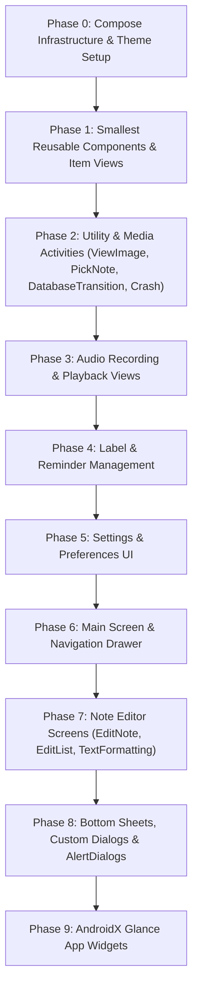

# NotallyX Jetpack Compose Migration Plan

This document outlines the step-by-step strategy for incrementally migrating **NotallyX** from Android XML Views (ViewBinding / DataBinding) to **Jetpack Compose**.

The migration is structured into **phased, ordered modules**, starting with the smallest reusable UI views and sub-components, progressing through screens and complex editors, and concluding with custom dialogs, `AlertDialog`s, and AppWidgets.
FOR EVERY MIGRATION USE THE `migrate-xml-views-to-jetpack-compose` SKILL.
---

## Architecture & Migration Principles

1. **Incremental Adoption via `ComposeView` & `AbstractComposeView`**:
   - Fragments and Activities can host `ComposeView` inside ViewBinding layouts during transition.
   - List Adapters can render Compose content inside `RecyclerView.ViewHolder` via `ComposeView`.
   - ViewModels remain unchanged (using existing `StateFlow` and `CoroutineScope` flows), providing state directly to Composables using `collectAsStateWithLifecycle()`.

2. **Single Source of Truth for Material 3 Styling**:
   - Create a central Composable theme `NotallyXTheme` based directly on the app's existing themes defined in [`values/themes.xml`](file:///home/user/AndroidStudioProjects/NotallyX/app/src/main/res/values/themes.xml), [`values-night/themes.xml`](file:///home/user/AndroidStudioProjects/NotallyX/app/src/main/res/values-night/themes.xml) (including the **SuperDark** `#000000` pitch-black theme mode `AppTheme.SuperDark`), and [`colors.xml`](file:///home/user/AndroidStudioProjects/NotallyX/app/src/main/res/values/colors.xml).
   - Dynamically map user theme selections from `NotallyXPreferences` (Light, Dark, and SuperDark/AMOLED) to Compose `lightColorScheme()` and `darkColorScheme()` definitions.

3. **Visual & Behavioral Parity via Roborazzi**:
   - Support light/dark mode, edge-to-edge window insets, dynamic accent colors, and custom font scaling across all converted views.
   - Use `@Preview` annotations for every Composable component for rapid visual verification.
   - Leverage the existing Roborazzi screenshot test suite in [`ScreenshotTests.kt`](file:///home/user/AndroidStudioProjects/NotallyX/app/src/test/kotlin/com/philkes/notallyx/presentation/activity/main/ScreenshotTests.kt) (`editNote`, `settings`, `navigationDrawer`, `labels`, `reminders`, `notesOverview`) to record reference screenshots before migration and verify pixel-perfect parity after each phase using `./gradlew verifyRoborazziDebug`.

4. **Active Replacement of Legacy XML Layout Usages**:
   - Each phase and checklist item mandates not only writing the new Composable functions, but also **actively replacing all legacy XML ViewBinding/DataBinding layout usages** in the corresponding Activities, Fragments, ViewHolders, Adapters, and Dialogs.
   - Activities/Fragments replace `setContentView(binding.root)` with `setContent { NotallyXTheme { Screen(...) } }`.
   - ViewHolders/Adapters replace ViewBinding inflation with `ComposeView` hosting the new Composable.
   - A step or phase is completed **only when the newly created Compose view is actively used in place of the XML view in app execution**.

---

## Phase Breakdown & Domain Groups

---

## Detailed Implementation Steps

### Phase 0: Compose Dependencies & Theme Infrastructure

#### 1. Build Configuration Setup
- Edit [`gradle/libs.versions.toml`](file:///home/user/AndroidStudioProjects/NotallyX/gradle/libs.versions.toml) and [`app/build.gradle.kts`](file:///home/user/AndroidStudioProjects/NotallyX/app/build.gradle.kts):
  - Enable Compose build feature: `buildFeatures { compose = true }`.
  - Add Compose BOM (`androidx.compose:compose-bom`), `androidx.compose.material3:material3`, `androidx.compose.ui:ui`, `androidx.compose.ui:ui-tooling-preview`, `androidx.activity:activity-compose`, `androidx.lifecycle:lifecycle-runtime-compose`, and `androidx.navigation:navigation-compose`.

#### 2. NotallyX Theme & Color Tokens
- Create Composable theme in `com.philkes.notallyx.presentation.theme`:
  - `NotallyXTheme.kt`: Maps light, dark, and superdark theme modes based on [`values/themes.xml`](file:///home/user/AndroidStudioProjects/NotallyX/app/src/main/res/values/themes.xml), [`values-night/themes.xml`](file:///home/user/AndroidStudioProjects/NotallyX/app/src/main/res/values-night/themes.xml), and [`colors.xml`](file:///home/user/AndroidStudioProjects/NotallyX/app/src/main/res/values/colors.xml) (`AppTheme`, `AppTheme.SuperDark`, `md_theme_*`, `ContainerSuperDark`).
  - `Typography.kt`: Maps typography and font size preferences (`textSizeOverview`).
  - `Color.kt`: M3 color palette constants mirroring [`colors.xml`](file:///home/user/AndroidStudioProjects/NotallyX/app/src/main/res/values/colors.xml) definitions.

---

### Phase 1: Smallest Reusable UI Components & List Items (ViewHolders)

Begin with isolated sub-views, chips, and list item ViewHolders. Each component receives a dedicated Composable with `@Preview`.

| candidate | Target Layout XML | Affected Adapter / VH | Composable File |
| :--- | :--- | :--- | :--- |
| **Drawer Header** | [`drawer_header.xml`](file:///home/user/AndroidStudioProjects/NotallyX/app/src/main/res/layout/drawer_header.xml) | `MainActivity` Drawer | `DrawerHeaderView.kt` |
| **Menu Item** | [`menu_item.xml`](file:///home/user/AndroidStudioProjects/NotallyX/app/src/main/res/layout/menu_item.xml) | [`MenuDialog.kt`](file:///home/user/AndroidStudioProjects/NotallyX/app/src/main/java/com/philkes/notallyx/presentation/view/misc/MenuDialog.kt) | `MenuItemRow.kt` |
| **Label Item** | [`label.xml`](file:///home/user/AndroidStudioProjects/NotallyX/app/src/main/res/layout/label.xml) | `LabelVH`, `SelectableLabelVH` | `LabelChip.kt` |
| **Error View** | [`error.xml`](file:///home/user/AndroidStudioProjects/NotallyX/app/src/main/res/layout/error.xml) | `ErrorVH` | `ErrorStateCard.kt` |
| **Recycler Header** | [`recycler_header.xml`](file:///home/user/AndroidStudioProjects/NotallyX/app/src/main/res/layout/recycler_header.xml) | `HeaderVH` | `SectionHeaderItem.kt` |
| **Recycler Toggle** | [`recycler_toggle.xml`](file:///home/user/AndroidStudioProjects/NotallyX/app/src/main/res/layout/recycler_toggle.xml) | `ToggleVH` | `ToggleOptionItem.kt` |
| **Color Circle** | [`recycler_color.xml`](file:///home/user/AndroidStudioProjects/NotallyX/app/src/main/res/layout/recycler_color.xml) | `ColorVH` | `ColorSwatchItem.kt` |
| **Label Chips in List** | [`recycler_label.xml`](file:///home/user/AndroidStudioProjects/NotallyX/app/src/main/res/layout/recycler_label.xml), [`recycler_selectable_label.xml`](file:///home/user/AndroidStudioProjects/NotallyX/app/src/main/res/layout/recycler_selectable_label.xml) | `LabelAdapter`, `SelectableLabelAdapter` | `LabelItemRow.kt` |
| **Reminder Chips** | [`recycler_reminder.xml`](file:///home/user/AndroidStudioProjects/NotallyX/app/src/main/res/layout/recycler_reminder.xml), [`recycler_note_reminder.xml`](file:///home/user/AndroidStudioProjects/NotallyX/app/src/main/res/layout/recycler_note_reminder.xml) | `ReminderVH` | `ReminderChipItem.kt` |
| **Preview Chips** | [`recycler_preview_file.xml`](file:///home/user/AndroidStudioProjects/NotallyX/app/src/main/res/layout/recycler_preview_file.xml), [`recycler_preview_image.xml`](file:///home/user/AndroidStudioProjects/NotallyX/app/src/main/res/layout/recycler_preview_image.xml) | `PreviewFileVH`, `PreviewImageVH` | `FileAttachmentPreviewChip.kt` |
| **Checklist Item** | [`recycler_list_item.xml`](file:///home/user/AndroidStudioProjects/NotallyX/app/src/main/res/layout/recycler_list_item.xml) | `ListItemVH` | `ChecklistItemRow.kt` |
| **Base Note Card** | [`recycler_base_note.xml`](file:///home/user/AndroidStudioProjects/NotallyX/app/src/main/res/layout/recycler_base_note.xml) | `BaseNoteVH` | `BaseNoteCard.kt` |

---

### Phase 2: Simple Utility & Media Display Activities

Convert simple standalone activities and secondary screens.

#### 1. Pick Note Screen
- **Files**: [`activity_pick_note.xml`](file:///home/user/AndroidStudioProjects/NotallyX/app/src/main/res/layout/activity_pick_note.xml), [`PickNoteActivity.kt`](file:///home/user/AndroidStudioProjects/NotallyX/app/src/main/java/com/philkes/notallyx/presentation/activity/note/PickNoteActivity.kt)
- **Target**: `PickNoteScreen.kt` using `Scaffold`, TopAppBar, and `LazyVerticalStaggeredGrid` / `LazyColumn` presenting `BaseNoteCard`.

#### 2. View Image Screen
- **Files**: [`activity_view_image.xml`](file:///home/user/AndroidStudioProjects/NotallyX/app/src/main/res/layout/activity_view_image.xml), [`recycler_image.xml`](file:///home/user/AndroidStudioProjects/NotallyX/app/src/main/res/layout/recycler_image.xml), [`ViewImageActivity.kt`](file:///home/user/AndroidStudioProjects/NotallyX/app/src/main/java/com/philkes/notallyx/presentation/activity/note/ViewImageActivity.kt)
- **Target**: `ViewImageScreen.kt` using `HorizontalPager` with zoomable image container and action bar.

#### 3. Database Transition & Progress Activity
- **Files**: [`activity_database_transition.xml`](file:///home/user/AndroidStudioProjects/NotallyX/app/src/main/res/layout/activity_database_transition.xml), [`DatabaseTransitionActivity.kt`](file:///home/user/AndroidStudioProjects/NotallyX/app/src/main/java/com/philkes/notallyx/presentation/activity/DatabaseTransitionActivity.kt)
- **Target**: `DatabaseTransitionScreen.kt` displaying state progress animation and messages.

#### 4. Crash & Error Activity
- **Files**: [`activity_error.xml`](file:///home/user/AndroidStudioProjects/NotallyX/app/src/main/res/layout/activity_error.xml), `ErrorActivity.kt`
- **Target**: `ErrorScreen.kt` with expandable stack trace and action buttons.

---

### Phase 3: Audio Recording & Playback Activities

#### 1. Play Audio Activity
- **Files**: [`activity_play_audio.xml`](file:///home/user/AndroidStudioProjects/NotallyX/app/src/main/res/layout/activity_play_audio.xml), [`recycler_audio.xml`](file:///home/user/AndroidStudioProjects/NotallyX/app/src/main/res/layout/recycler_audio.xml), `PlayAudioActivity.kt`
- **Target**: `PlayAudioScreen.kt` with seek bar, playback controls, and title header.

#### 2. Record Audio Activity
- **Files**: [`activity_record_audio.xml`](file:///home/user/AndroidStudioProjects/NotallyX/app/src/main/res/layout/activity_record_audio.xml), `RecordAudioActivity.kt`
- **Target**: `RecordAudioScreen.kt` with waveform indicator, timer, and record/stop controls.

---

### Phase 4: Label & Reminder Management Screens

#### 1. Label Management
- **Files**: [`activity_label.xml`](file:///home/user/AndroidStudioProjects/NotallyX/app/src/main/res/layout/activity_label.xml), `SelectLabelsActivity.kt`, `LabelsFragment.kt`
- **Target**: `SelectLabelsScreen.kt`, `LabelsScreen.kt` using `LazyColumn` for tag editing and re-ordering.

#### 2. Reminders Screen
- **Files**: [`activity_reminders.xml`](file:///home/user/AndroidStudioProjects/NotallyX/app/src/main/res/layout/activity_reminders.xml), `RemindersActivity.kt`, `RemindersFragment.kt`
- **Target**: `RemindersScreen.kt` with reminder items and date/time picker integrations.

---

### Phase 5: Preference & Settings Screens

#### 1. Custom Preference Items
- **Files**: [`preference.xml`](file:///home/user/AndroidStudioProjects/NotallyX/app/src/main/res/layout/preference.xml), [`preference_seekbar.xml`](file:///home/user/AndroidStudioProjects/NotallyX/app/src/main/res/layout/preference_seekbar.xml), [`preference_stepper.xml`](file:///home/user/AndroidStudioProjects/NotallyX/app/src/main/res/layout/preference_stepper.xml)
- **Target**: Preference composables (`PreferenceRow`, `SeekBarPreferenceRow`, `StepperPreferenceRow`).

#### 2. Settings Fragment
- **Files**: [`fragment_settings.xml`](file:///home/user/AndroidStudioProjects/NotallyX/app/src/main/res/layout/fragment_settings.xml), `SettingsFragment.kt`, `PreferenceBindingExtensions.kt`
- **Target**: `SettingsScreen.kt` grouped into categories (Theme, Backup, Security, Layout, Formatting) replacing `PreferenceFragmentCompat`.

---

### Phase 6: Main Screen, Drawer & Navigation

#### 1. Main Overview Fragments
- **Files**: [`fragment_notes.xml`](file:///home/user/AndroidStudioProjects/NotallyX/app/src/main/res/layout/fragment_notes.xml), `NotesFragment.kt`, `NotesOverviewFragment.kt`, `ArchivedFragment.kt`, `DeletedFragment.kt`, `UnlabeledFragment.kt`, `SearchFragment.kt`
- **Target**: `NotesGridScreen.kt` and `SearchScreen.kt` rendering `BaseNoteCard` in staggered grid or list mode.

#### 2. Main Activity
- **Files**: [`activity_main.xml`](file:///home/user/AndroidStudioProjects/NotallyX/app/src/main/res/layout/activity_main.xml), [`MainActivity.kt`](file:///home/user/AndroidStudioProjects/NotallyX/app/src/main/java/com/philkes/notallyx/presentation/activity/main/MainActivity.kt)
- **Target**: `MainScreen.kt` using Compose `ModalNavigationDrawer` / `PermanentNavigationDrawer` and `Scaffold`.

---

### Phase 7: Note Editor Activities

#### 1. Text Formatting Bar
- **Files**: [`bottom_text_formatting_menu.xml`](file:///home/user/AndroidStudioProjects/NotallyX/app/src/main/res/layout/bottom_text_formatting_menu.xml)
- **Target**: `TextFormattingBar.kt` toolbar composable for bold, italic, list, heading formatting.

#### 2. Edit Activity Suite
- **Files**: [`activity_edit.xml`](file:///home/user/AndroidStudioProjects/NotallyX/app/src/main/res/layout/activity_edit.xml), [`EditActivity.kt`](file:///home/user/AndroidStudioProjects/NotallyX/app/src/main/java/com/philkes/notallyx/presentation/activity/note/EditActivity.kt), `EditNoteActivity.kt`, `EditListActivity.kt`, `EditTextPlainActivity.kt`
- **Target**: `EditNoteScreen.kt` and `EditListScreen.kt` supporting rich body text, checklists, attachments, and color backgrounds.

---

### Phase 8: Bottom Sheets & Dialogs Migration

Once all primary screen layouts are migrated, convert all custom dialogs, bottom sheets, and `AlertDialog`s to Compose `Dialog` and `ModalBottomSheet` components.

#### 1. Bottom Sheet Actions
- **Files**: [`bottom_sheet_action.xml`](file:///home/user/AndroidStudioProjects/NotallyX/app/src/main/res/layout/bottom_sheet_action.xml), [`ActionBottomSheet.kt`](file:///home/user/AndroidStudioProjects/NotallyX/app/src/main/java/com/philkes/notallyx/presentation/view/note/action/ActionBottomSheet.kt), `ActionSelectionBottomSheet.kt`, `AddBottomSheet.kt`, `ExportBottomSheet.kt`, `MoreNoteBottomSheet.kt`
- **Target**: `ActionModalBottomSheet.kt` using Compose `ModalBottomSheet`.

#### 2. Custom Input & Selector Dialogs
- **Files & Components**:
  - `dialog_input.xml`, `dialog_text_input.xml`, `dialog_text_input_2.xml` -> `TextInputDialog.kt`
  - `dialog_add_more.xml` -> `AddMoreDialog.kt`
  - `dialog_notes_sort.xml` -> `NotesSortDialog.kt`
  - `dialog_color.xml`, `dialog_color_picker.xml` -> `ColorPickerDialog.kt`
  - `dialog_datetime_format.xml` -> `DateTimeFormatDialog.kt`
  - `dialog_import.xml` -> `ImportNotesDialog.kt`
  - `dialog_reminder_repetition.xml`, `dialog_reminder_custom_repetition.xml` -> `ReminderRepetitionDialog.kt`
  - `dialog_selection_box.xml`, `choice_item.xml`, `choice_item_tri_state.xml` -> `SelectionDialog.kt`
  - `dialog_preference_boolean.xml`, `dialog_preference_enum_with_toggle.xml` -> `PreferenceToggleDialog.kt`
  - `dialog_progress.xml`, `dialog_error.xml` -> `ProgressDialog.kt`, `ErrorDialog.kt`

#### 3. Standard MaterialAlertDialog Replacements
- Replace `MaterialAlertDialogBuilder` occurrences with reusable Compose `AlertDialog` dialog wrappers (`ConfirmDeleteDialog`, `BiometricLockDialog`, `ExportFormatDialog`).

---

### Phase 9: App Widgets Migration (AndroidX Glance)

Convert legacy Android RemoteViews widgets to **AndroidX Glance**:
- **Files**: `widget.xml`, `widget_note.xml`, `widget_locked.xml`, `widget_preview.xml`, `widget_list_item.xml`, `widget_list_child_item.xml`, `widget_list_header.xml`
- **Target**: `NotallyXGlanceWidget.kt` using `GlanceAppWidget`.

---

## Ordered Execution Checklist

### Phase 0: Setup & Infrastructure
- [x] Add Compose dependencies and enable `compose = true` in [`app/build.gradle.kts`](file:///home/user/AndroidStudioProjects/NotallyX/app/build.gradle.kts).
- [x] Create `NotallyXTheme.kt`, `Typography.kt`, and `Color.kt` theme infrastructure mapping Light, Dark, and SuperDark themes from [`values/themes.xml`](file:///home/user/AndroidStudioProjects/NotallyX/app/src/main/res/values/themes.xml), [`values-night/themes.xml`](file:///home/user/AndroidStudioProjects/NotallyX/app/src/main/res/values-night/themes.xml), and [`colors.xml`](file:///home/user/AndroidStudioProjects/NotallyX/app/src/main/res/values/colors.xml).
- [x] Verify Gradle sync and build.

### Phase 1: Small Reusable UI Views & List Item ViewHolders
- [x] Implement `DrawerHeaderView.kt` (`drawer_header.xml`).
- [x] Implement `MenuItemRow.kt` (`menu_item.xml`).
- [x] Implement `LabelChip.kt` (`label.xml`).
- [x] Implement `ErrorStateCard.kt` (`error.xml`).
- [x] Implement `SectionHeaderItem.kt` (`recycler_header.xml`).
- [x] Implement `ToggleOptionItem.kt` (`recycler_toggle.xml`).
- [x] Implement `ColorSwatchItem.kt` (`recycler_color.xml`).
- [x] Implement `LabelItemRow.kt` (`recycler_label.xml`, `recycler_selectable_label.xml`).
- [x] Implement `ReminderChipItem.kt` (`recycler_reminder.xml`, `recycler_note_reminder.xml`).
- [x] Implement `FileAttachmentPreviewChip.kt` (`recycler_preview_file.xml`, `recycler_preview_image.xml`).
- [x] Implement `ChecklistItemRow.kt` (`recycler_list_item.xml`).
- [x] Implement `BaseNoteCard.kt` (`recycler_base_note.xml`).

### Phase 2: Simple Utility & Media Display Activities
- [x] Migrate `PickNoteActivity` to `PickNoteScreen.kt` (`activity_pick_note.xml`).
- [x] Migrate `ViewImageActivity` to `ViewImageScreen.kt` (`activity_view_image.xml`, `recycler_image.xml`).
- [x] Migrate `DatabaseTransitionActivity` to `DatabaseTransitionScreen.kt` (`activity_database_transition.xml`).
- [x] Migrate `ErrorActivity` to `ErrorScreen.kt` (`activity_error.xml`).

### Phase 3: Audio Recording & Playback
- [x] Migrate `PlayAudioActivity` to `PlayAudioScreen.kt` (`activity_play_audio.xml`, `recycler_audio.xml`).
- [x] Migrate `RecordAudioActivity` to `RecordAudioScreen.kt` (`activity_record_audio.xml`).

### Phase 4: Label & Reminder Management
- [x] Migrate `SelectLabelsActivity` & `LabelsFragment` to Compose (`activity_label.xml`).
- [x] Migrate `RemindersActivity` & `RemindersFragment` to Compose (`activity_reminders.xml`).

### Phase 5: Preference & Settings UI
- [x] Implement `PreferenceRow.kt`, `SeekBarPreferenceRow.kt`, `StepperPreferenceRow.kt` (`preference.xml`, `preference_seekbar.xml`, `preference_stepper.xml`).
- [x] Migrate `SettingsFragment` to `SettingsScreen.kt` (`fragment_settings.xml`).

### Phase 6: Main Navigation & Overview Fragments
- [x] Migrate `NotesFragment` and overview fragments to `NotesGridScreen.kt` (`fragment_notes.xml`).
- [x] Migrate `MainActivity` to `MainScreen.kt` (`activity_main.xml`).

### Phase 7: Note Editor Screens
- [x] Implement `TextFormattingBar.kt` (`bottom_text_formatting_menu.xml`).
- [x] Migrate `EditActivity`, `EditNoteActivity`, `EditListActivity` to Compose (`activity_edit.xml`).

### Phase 8: Bottom Sheets & Dialogs
- [x] Migrate `ActionBottomSheet` & actions to `ActionModalBottomSheet.kt` (`bottom_sheet_action.xml`).
- [x] Migrate input & text dialogs (`dialog_input.xml`, `dialog_text_input.xml`, `dialog_text_input_2.xml`).
- [x] Migrate `dialog_add_more.xml`, `dialog_notes_sort.xml`, `dialog_datetime_format.xml`, `dialog_import.xml`.
- [x] Migrate color picker dialogs (`dialog_color.xml`, `dialog_color_picker.xml`).
- [x] Migrate reminder repetition dialogs (`dialog_reminder_repetition.xml`, `dialog_reminder_custom_repetition.xml`).
- [x] Migrate selection dialogs (`dialog_selection_box.xml`, `dialog_preference_boolean.xml`, `dialog_preference_enum_with_toggle.xml`).
- [x] Migrate progress and error dialogs (`dialog_progress.xml`, `dialog_error.xml`).
- [x] Replace all `MaterialAlertDialogBuilder` calls with Compose `AlertDialog` components.
- [x] Remove unused XML layout files from `app/src/main/res/layout/`.

### Phase 9: AndroidX Glance App Widgets
- [ ] Migrate app widgets (`widget.xml`, `widget_note.xml`, `widget_locked.xml`, `widget_preview.xml`, `widget_list_item.xml`, `widget_list_child_item.xml`, `widget_list_header.xml`) to AndroidX Glance.

---

## Verification & Validation Plan

1. **Roborazzi Screenshot Testing with `ScreenshotTests`**:
   - Utilize the existing Roborazzi test suite in [`ScreenshotTests.kt`](file:///home/user/AndroidStudioProjects/NotallyX/app/src/test/kotlin/com/philkes/notallyx/presentation/activity/main/ScreenshotTests.kt), which captures screenshots for `EditNoteActivity`, `SettingsFragment`, `NavigationDrawer`, `LabelsFragment`, `RemindersFragment`, and `NotesOverviewFragment`.
   - Record baseline images prior to migrating each phase: `./gradlew recordRoborazziDebug`.
   - Run verification after migration to compare results and confirm visual parity: `./gradlew verifyRoborazziDebug`.
   - Expand `ScreenshotTests.kt` with new test methods for standalone composables as new screens are migrated.
2. **Unit & UI Tests**:
   - Run existing instrumented and unit tests (`./gradlew test`) to ensure interaction callbacks, ViewModel state flows, and navigation behave identically.
3. **Code Formatting**:
   - Run `./gradlew ktfmtFormat` to ensure all new Composable functions adhere to project formatting standards.
4. **Remove migrated XML View**:
   - Remove the obsolete XML View files
