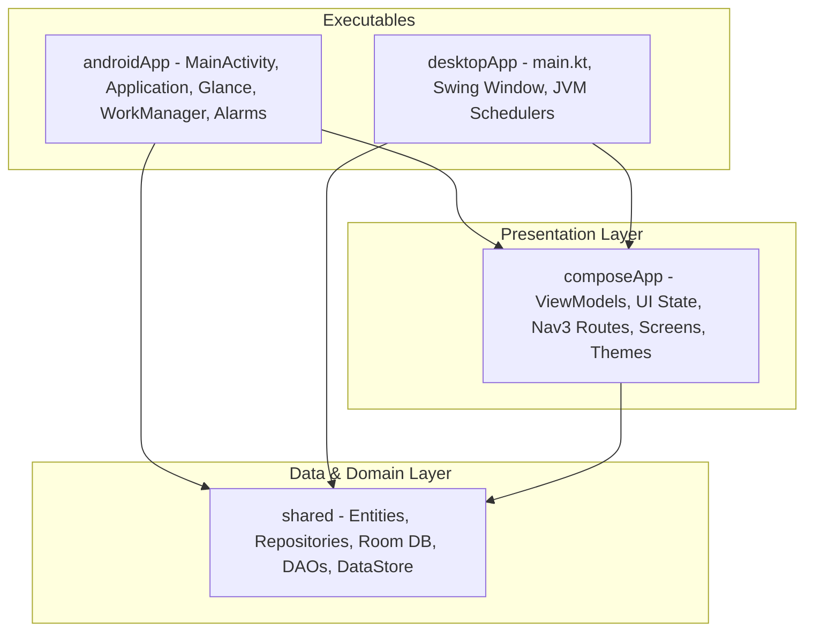
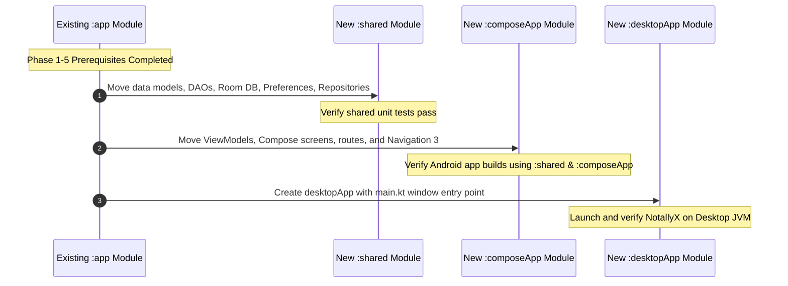

# 05. Proposed Future KMP Architecture

## Overview

This document outlines the refined target **multi-module Kotlin Multiplatform (KMP)** architecture for **NotallyX**, targeting **Android** and **Desktop (JVM)**.

---

## Target Module Structure

```
NotallyX/
├── shared/                                            # Pure Domain & Data Layer (NO ViewModels / NO Compose)
│   ├── src/
│   │   ├── commonMain/                                # Entities, Repositories, DAOs, Room DB, DataStore, Interfaces
│   │   ├── androidMain/                               # Android PathProvider, Android SQLite Driver Factory
│   │   └── desktopMain/                               # Desktop OS App Data PathProvider, BundledSQLiteDriver Factory
│   └── build.gradle.kts
├── composeApp/                                        # Presentation Layer (Compose Multiplatform & ViewModels)
│   ├── src/
│   │   ├── commonMain/                                # ViewModels, UI State, Nav3 Routes, Screens, Themes, FilePicker Interface
│   │   ├── androidMain/                               # Android Activity Launchers, Android FilePicker Implementation
│   │   └── desktopMain/                               # Desktop Swing FilePicker Implementation, Window Utilities
│   └── build.gradle.kts
├── androidApp/                                        # Android Application Entry Point
│   ├── src/main/                                      # MainActivity, NotallyXApplication, Glance Widgets, WorkManager, Alarms
│   └── build.gradle.kts
├── desktopApp/                                        # Desktop JVM Application Entry Point
│   ├── src/main/kotlin/                               # main.kt, Desktop Window, JVM Schedulers, kotlinx-coroutines-swing
│   └── build.gradle.kts
└── settings.gradle.kts                                # Module inclusions
```

---

## Module Dependencies & Architectural Diagram



> **Initialization Pattern**: Executable modules (`androidApp`, `desktopApp`) perform platform-level startup (DI initialization, platform binding registrations) and hand control directly to `composeApp`. `composeApp` depends on `shared`.

---

## Layer Responsibilities & Component Distribution

| Module | Target Platforms | Primary Responsibilities | Included Components |
| :--- | :--- | :--- | :--- |
| **`shared`** | `commonMain`<br>`androidMain`<br>`desktopMain` | Domain Entities, Repositories, Room 3 Database, DAOs, DataStore Preferences, Platform Interfaces (`PathProvider`, `FileStorage`, `TaskScheduler`, `ReminderScheduler`). | `data/model/`, `data/dao/`, `core/database/`, `core/preference/`, `repository/`. |
| **`composeApp`** | `commonMain`<br>`androidMain`<br>`desktopMain` | Multiplatform ViewModels (`androidx.lifecycle.ViewModel`), UI State, Navigation 3 `NavDisplay` with `rememberViewModelStoreNavEntryDecorator()`, Screens, Themes, `FilePicker` interface. | `feature/*/ViewModel`, `feature/*/Model`, `feature/*/Screen`, `feature/*/Route`, `core/ui/`, `navigation/`. |
| **`androidApp`** | `android` (JVM) | **Android Application Entry**: `MainActivity`, `NotallyXApplication`, Glance Widgets (`NoteWidget`), WorkManager Workers (`AutoBackupWorker`), AlarmReceivers (`ReminderReceiver`). Maintains experimental database encryption code behind `FEATURE_FLAG_BIOMETRIC_ENCRYPTS_DB = false`. | `NotallyXApplication`, `MainActivity`, `NoteWidget`, `AutoBackupWorker`, `ReminderReceiver`, `BiometricAuthenticator`. |
| **`desktopApp`** | `desktop` (JVM) | **Desktop Executable Entry**: `main.kt`, Compose Multiplatform `Window`, JVM Scheduled Executor task schedulers, `kotlinx-coroutines-swing` setup, native packaging DSL. | `main.kt`, `DesktopWindow`, `DesktopTaskScheduler`. |

---

## Key Architectural Solutions & Refinements

### 1. ViewModels in `:composeApp`
ViewModels reside strictly in `:composeApp` alongside UI screens, Navigation 3 routes, and UI state models. This keeps `:shared` completely decoupled from presentation logic and avoids circular dependencies.

### 2. Database Encryption Feature Flag
Database encryption with SQLCipher is disabled across all platforms. On Android, the SQLCipher implementation is preserved behind a global hardcoded feature flag:
```kotlin
const val FEATURE_FLAG_BIOMETRIC_ENCRYPTS_DB = false
```
Because the flag is set to `false`, database encryption is never activated at runtime on Android, and is omitted on Desktop.

### 3. File Choosers & FilePickers
An explicit `FilePicker` interface is defined in `:composeApp/commonMain`. `composeApp/androidMain` implements it using Android Activity Result Launchers / SAF, while `composeApp/desktopMain` implements it using Swing `JFileChooser` / AWT `FileDialog`.

### 4. Background Task & Reminder Scheduling
Background tasks (auto-backups) and note reminders use abstract interfaces in `:shared/commonMain`:
- `TaskScheduler`
- `ReminderScheduler`

On Android, `androidApp` supplies `WorkManager` and `AlarmManager` implementations. On Desktop, `desktopApp` supplies JVM `ScheduledExecutorService` or coroutine-based background schedulers.

### 5. Room 3 KMP SQLite Driver Setup & Native Packaging
Desktop JVM uses `androidx.sqlite.driver.bundled.BundledSQLiteDriver`. The Compose Multiplatform Gradle plugin packaging options in `desktopApp/build.gradle.kts` handle packaging native SQLite binaries across macOS (ARM64/x86_64), Linux (x64/aarch64), and Windows (x64).

---

## Gradual Evolutionary Migration Strategy


