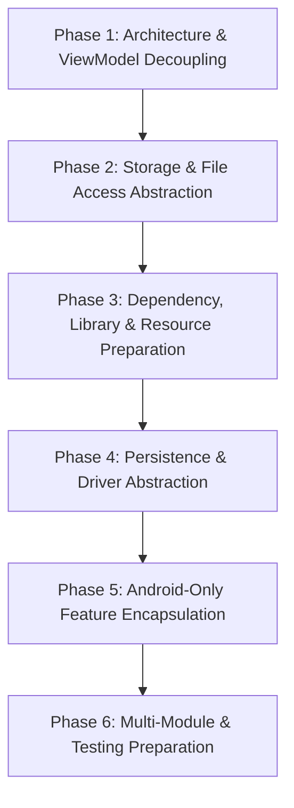

# NotallyX Kotlin Multiplatform (KMP) Migration Prerequisites Plan

## Initiative Overview

This document suite outlines the **Prerequisites Plan** for preparing the existing **NotallyX** Android codebase for a future migration to **Kotlin Multiplatform (KMP)** targeting **Android** and **Desktop (JVM)**.

> [!IMPORTANT]
> **Scope & Objective**: This initiative focuses strictly on **prerequisite architecture preparation and analysis**. The documents themselves do **NOT** execute the migration. The `PREP-*` tasks they describe are source-code refactorings that are completed incrementally **inside the current single-module `:app` project** before any KMP modules (`shared`, `composeApp`, `desktopApp`) are introduced.
> **Target Platforms**: Exactly **Android** and **Desktop (JVM)**. Non-JVM targets (iOS, Web/Wasm) are explicitly out of scope.

> [!NOTE]
> **Target-module notation**: Whenever a task says "create `X` in `:shared/commonMain`" or "`:composeApp/androidMain`", it means: create `X` **inside `:app` now**, in a package that maps 1:1 to the future module/source set (see the package mapping in [05-proposed-kmp-architecture.md](./05-proposed-kmp-architecture.md#package-to-module-mapping)), and keep it free of APIs that the target source set cannot compile. Code is physically moved only after the Go/No-Go gate in [07-migration-readiness-checklist.md](./07-migration-readiness-checklist.md).

> [!TIP]
> **Android-Only Features**: The Biometric/PIN lock UI, Glance widgets, AlarmManager reminders/notifications and WorkManager background jobs are **Android-Only Features**. Their scheduling **interfaces** live in `:shared`, but on Desktop they get **No-Op implementations** at first (see open questions OQ-01/OQ-02 in [06](./06-risks-and-open-questions.md#open-questions)). Database encryption (SQLCipher) is **currently a live opt-in feature on Android**. `PREP-012` introduces `FEATURE_FLAG_BIOMETRIC_ENCRYPTS_DB = false` and **decrypts existing encrypted databases** before turning the feature off. Desktop JVM uses standard unencrypted Room 3 and DataStore in the standard OS application data directories.

---

## Executive Summary & Assessment

**NotallyX** is currently a modern, 100% Jetpack Compose Android app built with Kotlin 2.4.20, AGP 9.4.1, Room 3, Jetpack DataStore, Koin 4.2.2, and Jetpack Navigation 3. It adheres to an MVI (Unidirectional Data Flow) architecture using a standardized 4-File Feature Quad (`Model.kt`, `ViewModel.kt`, `Screen.kt`, `Route.kt`).

### Migration Readiness Scorecard

| Area | Current State | KMP Readiness | Main Challenge |
| :--- | :--- | :--- | :--- |
| **UI Framework** | 100% Jetpack Compose (Material 3) | **High** (80%) | Replacing Android-specific Compose extensions, SAF launchers and share/camera intents. Skydoves ColorPicker is already KMP native. |
| **Resources & i18n** | Android `res/` (`R.string`, plurals, vector drawables), 30 translated locales, Android-specific translation Gradle plugins | **Low** (40%) | Migrating to Compose Multiplatform Resources (`Res.*`), removing `R`/`@StringRes` from ViewModels and side effects, keeping the translation tooling working. |
| **Architecture** | Feature Quad MVI, AndroidX `ViewModel` (5 classes extend `AndroidViewModel`, about 25 ViewModels take `Application`) | **Medium** (60%) | Removing `Application`/`Context`, `android.net.Uri`, `R`, `Manifest`/`PackageManager` and `PdfPrintListener` from ViewModels. The Nav 3 entry decorators are already in place. |
| **Data & Persistence** | Room 3 & Jetpack DataStore, `org.json` converters, `@Parcelize` models, live opt-in SQLCipher | **Medium** (70%) | Room 3 and DataStore are KMP-native. Still to do: replace `org.json`/`Parcelable`/`android.util.*`, abstract the driver, and decrypt existing SQLCipher databases. |
| **Platform Services** | WorkManager, AlarmManager, Media3, WebView-based PDF export | **Medium** (70%) | WorkManager, alarms, biometrics and Glance are Android-only (retained in `androidApp`). Desktop audio (AAC/m4a) and Desktop PDF export need dedicated solutions. |
| **Build & Packaging** | Single `:app` module with Gradle Kotlin DSL, `build-logic` included build | **Medium** (60%) | Splitting into a multi-module KMP layout under AGP 9 constraints (`com.android.kotlin.multiplatform.library` for KMP modules), plus Desktop distribution. |

---

## Documentation Index

The plan is organized across seven documents in `docs/kmp-migration/` plus one reference document:

1. [**01-current-architecture.md**](./01-current-architecture.md)  
   Comprehensive audit of NotallyX's existing codebase, layer organization, tech stack, and module structure.
2. [**02-kmp-compatibility-analysis.md**](./02-kmp-compatibility-analysis.md)  
   In-depth analysis of Android framework coupling, third-party library compatibility matrix, and Android-only feature boundaries.
3. [**03-prerequisites-roadmap.md**](./03-prerequisites-roadmap.md)  
   Prioritized, actionable roadmap featuring 22 detailed task tickets (`PREP-001` to `PREP-022`) across 6 logical phases.
4. [**04-technology-recommendations.md**](./04-technology-recommendations.md)  
   Evaluations and specific tech stack recommendations for Compose Multiplatform, Compose Multiplatform Resources, Koin KMP, Multiplatform ViewModel in `:composeApp`, Nav 3, Room 3 KMP, DataStore KMP, and `kotlinx-coroutines-swing`.
5. [**05-proposed-kmp-architecture.md**](./05-proposed-kmp-architecture.md)  
   Proposed multi-module target structure (`shared`, `composeApp`, `androidApp`, `desktopApp`) with module dependency diagrams, package-to-module mapping, and migration steps.
6. [**06-risks-and-open-questions.md**](./06-risks-and-open-questions.md)  
   Technical risk matrix, data migration concerns, desktop UX considerations, resolved decisions, and **open questions**.
7. [**07-migration-readiness-checklist.md**](./07-migration-readiness-checklist.md)  
   Objective, measurable Go/No-Go checklist to evaluate readiness before beginning KMP module creation.

**Reference**: [`references/kmp-viewmodel.md`](./references/kmp-viewmodel.md): official JetBrains guide on Multiplatform ViewModel, Navigation 3 scoping and Koin integration.

---

## Recommended Execution Order

To minimize risk and maintain a working Android application at every step, preparation tasks should be executed in the following sequential phases:

> [!NOTE]
> Phases describe a recommended order, not hard barriers. Each ticket's explicit **Dependencies** field is authoritative. For example, `PREP-018` (build-logic) and `PREP-012` (encryption sunset) can start early.

### Phase Summary & Task References

1. **Phase 1: Architecture & ViewModel Decoupling** (`PREP-001` – `PREP-003`, `PREP-020` – `PREP-022`)
   - Remove `ContextWrapper` / `Context` from database creation and DAOs.
   - Remove `android.net.Uri` from model extensions and ViewModels (use path strings / abstractions).
   - Remove `AndroidViewModel` / `Application` from ViewModels. Verify the Nav 3 entry decorators already configured in `NavigationState.kt`.
   - Replace Android-only utility APIs in domain/data code (`org.json`, `android.util.Base64`, `android.text.Html`, `android.util.Log`, `MimeTypeMap`, `@Parcelize`).
   - Make the Nav 3 back stack serializable on non-Android targets (polymorphic `NotallyNavKey` `SavedStateConfiguration`).
   - Abstract platform intents and runtime permission checks (share, email, open file, `PackageManager`).
2. **Phase 2: Storage & File Access Abstraction** (`PREP-004` – `PREP-006`)
   - Introduce `FileStorage` in `:shared` and `FilePicker` in `:composeApp`.
   - Abstract PDF generation (currently WebView + `PrintDocumentAdapter` in `android/print/PdfExtensions.kt`).
   - Standardize `PathProvider` resolving to standard OS app data directories on Desktop.
3. **Phase 3: Dependency, Library & Resource Preparation** (`PREP-007` – `PREP-009`, `PREP-019`)
   - Confirm `Skydoves ColorPicker` multiplatform usage in shared UI.
   - Decide on relative date formatting (PrettyTime is JVM-compatible; `kotlinx-datetime` has no relative formatting).
   - Audit and isolate Android-specific Compose utilities.
   - Migrate Android resources to Compose Multiplatform Resources and remove `R` from ViewModels.
4. **Phase 4: Persistence & Driver Abstraction** (`PREP-010` – `PREP-012`)
   - Prepare Room 3 for KMP (`SQLiteDriver` factory abstraction, `BundledSQLiteDriver` on Desktop).
   - Encapsulate Tink AEAD DataStore encryption as an Android-only feature behind a `SecurePreferencesStore` interface.
   - Sunset database encryption: introduce `FEATURE_FLAG_BIOMETRIC_ENCRYPTS_DB = false` and decrypt existing encrypted databases.
5. **Phase 5: Android-Only Feature Encapsulation** (`PREP-013` – `PREP-016`)
   - Encapsulate `NotificationManager` / `AlarmManager` reminders behind `ReminderScheduler` (Android impl in `androidApp`, No-Op on Desktop).
   - Abstract audio recording & playback (`Media3` / `ExoPlayer` / `MediaRecorder`).
   - Isolate `WorkManager` workers (`AutoBackupWorker`, `AutoRemoveDeletedNotesWorker`, `CleanupMissingAttachmentsWorker`) behind `TaskScheduler`.
   - Isolate `BiometricPrompt` / `LockedActivity` in `androidApp`.
6. **Phase 6: Multi-Module & Testing Preparation** (`PREP-017` – `PREP-018`)
   - Isolate Robolectric / Android-specific unit tests from pure Kotlin unit tests and split `:test-lib`.
   - Restructure Gradle build logic for future `kotlin("multiplatform")` + `com.android.kotlin.multiplatform.library` plugin application.

---

## Progress Tracking

| Phase | Description | Total Tasks | Completed | Status |
| :--- | :--- | :---: | :---: | :--- |
| **Phase 1** | Architecture & ViewModel Decoupling | 6 | 0 | Pending |
| **Phase 2** | Storage & File Access Abstraction | 3 | 0 | Pending |
| **Phase 3** | Dependency, Library & Resource Preparation | 4 | 0 | Pending |
| **Phase 4** | Persistence & Driver Abstraction | 3 | 0 | Pending |
| **Phase 5** | Android-Only Feature Encapsulation | 4 | 0 | Pending |
| **Phase 6** | Multi-Module & Testing Preparation | 2 | 0 | Pending |
| **Total** | **All Preparation Phases** | **22** | **0** | **Blocked on open questions marked "Blocking" in [06](./06-risks-and-open-questions.md#open-questions)** |
