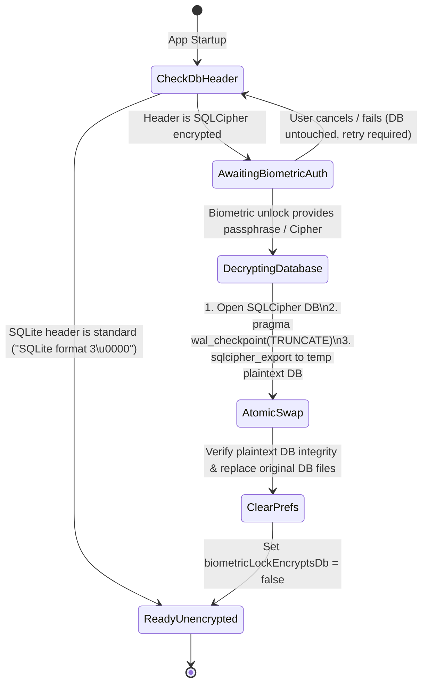

# Data Model: Multiplatform Migration Prerequisites

**Feature**: `002-kmp-migration-prep`  
**Date**: 2026-11-01  
**Status**: Completed  

---

## 1. Overview

This document defines the portable domain entities, serialization invariants, platform abstraction models, and database decryption state transitions required to prepare **NotallyX** for Kotlin Multiplatform (Android + Desktop JVM) while maintaining 100% backward compatibility with existing Room v1–v11 schemas and backups.

---

## 2. Core Domain Entities (Portable Invariants)

All entities under `com.philkes.notallyx.data.model` MUST be pure Kotlin classes annotated with `@Serializable` (`kotlinx.serialization`) and Room annotations (`@Entity`), with **zero** `android.os.Parcelable`, `@Parcelize`, or `android.net.Uri` references.

### 2.1 `BaseNote` (`@Entity(tableName = "BaseNote")`)
| Field | Type | Storage / Serialization | Portability Invariant |
| :--- | :--- | :--- | :--- |
| `id` | `Long` | `@PrimaryKey(autoGenerate = true)` | Unchanged |
| `type` | `Type` (`NOTE`, `LIST`) | Room Enum / String | Pure Kotlin `enum class` |
| `folder` | `Folder` (`NOTES`, `DELETED`, `ARCHIVED`) | Room Enum / String | Pure Kotlin `enum class` |
| `color` | `ColorString` (`String`) | Raw String | Portable hex / named color string |
| `title` | `String` | TEXT | Unchanged |
| `pinned` | `Boolean` | INTEGER | Unchanged |
| `timestamp` | `Long` | INTEGER (epoch millis) | Unchanged |
| `modifiedTimestamp` | `Long` | INTEGER (epoch millis) | Unchanged |
| `labels` | `List<String>` | JSON Array via `Converters` | Serialized via `kotlinx.serialization.json` |
| `body` | `String` | TEXT | Unchanged |
| `spans` | `List<SpanRepresentation>` | JSON Array via `Converters` | Serialized via `kotlinx.serialization.json` |
| `items` | `List<ListItem>` | JSON Array via `Converters` | Serialized via `kotlinx.serialization.json` |
| `images` | `List<FileAttachment>` | JSON Array via `Converters` | Relative filename in `localName` (never `content://`) |
| `files` | `List<FileAttachment>` | JSON Array via `Converters` | Relative filename in `localName` (never `content://`) |
| `audios` | `List<Audio>` | JSON Array via `Converters` | Relative filename in `name` (`*.m4a`) |
| `reminders` | `List<Reminder>` | JSON Array via `Converters` | Serialized via `kotlinx.serialization.json` |
| `viewMode` | `NoteViewMode` | Room Enum / String | Pure Kotlin `enum class` |

### 2.2 Attachment & Reminder Value Objects (De-Parcelized)
```kotlin
import kotlinx.serialization.Serializable

@Serializable
sealed interface Attachment

@Serializable
data class FileAttachment(
    var localName: String,
    var originalName: String,
    var mimeType: String,
) : Attachment

@Serializable
data class Audio(
    var name: String,
    val duration: Long?,
    val timestamp: Long,
) : Attachment

@Serializable
data class Reminder(
    val id: Long,
    val dateTime: Long, // epoch millis (replaces or wraps java.util.Date in JSON converter)
    val repetition: Repetition?,
    val isNotificationVisible: Boolean = false,
)
```

---

## 3. Portable Database JSON Format Specification (`Converters.kt`)

To guarantee zero-migration compatibility with existing v1–v11 SQLite databases and exported ZIP/JSON backups, `Converters` (`kotlinx.serialization.json`) MUST preserve the exact JSON keys produced previously by `org.json`:

| Entity List | JSON Element Format | Fallback / Repair Rule |
| :--- | :--- | :--- |
| `List<String>` (Labels) | `["label1","label2"]` | Malformed JSON reports to `ConverterErrorReporter` and returns `emptyList()` |
| `List<FileAttachment>` | `[{"localName":"...","originalName":"...","mimeType":"..."}]` | Legacy `name` field falls back to `localName` and `originalName` |
| `List<Audio>` | `[{"name":"...","duration":1234,"timestamp":1700000000000}]` | Missing/invalid `duration` defaults to `0L` or `null` safely |
| `List<SpanRepresentation>` | `[{"bold":true,"link":false,"linkData":null,"italic":false,"monospace":false,"strikethrough":false," start":0,"end":5}]` | Missing boolean flags default to `false`; invalid ranges (`start >= end`) filtered or repaired via `NoteRepairUtils` |
| `List<ListItem>` | `[{"body":"...","checked":false,"isChild":false,"order":0,"children":[]}]` | Missing `isChild` defaults to `false`; `order` defaults to index or `null` |
| `List<Reminder>` | `[{"id":1,"dateTime":1700000000000,"isNotificationVisible":false,"repetition":{"value":1,"unit":"DAYS"}}]` | Missing `isNotificationVisible` defaults to `false`; `repetition` optional |

---

## 4. Platform Abstraction Value Types

### 4.1 `PlatformFile` (Opaque File Handle)
Replaces `android.net.Uri` in ViewModels, importers, exporters, and model extensions:
```kotlin
/**
 * Platform-independent reference to a local file or content stream.
 * - On Android: wraps either a `file://` path or a SAF `content://` URI string.
 * - On Desktop JVM: wraps an absolute or relative filesystem path.
 */
@JvmInline
@Serializable
value class PlatformUri(val uriString: String)
```

### 4.2 `UiText` (Platform-Agnostic Localized Text)
Replaces `@StringRes Int` and `context.getString(...)` in ViewModels and `*Model.kt` `SideEffect`s:
```kotlin
sealed interface UiText {
    data class DynamicString(val value: String) : UiText
    data class Resource(
        val resId: MultiplatformStringId,
        val args: List<Any> = emptyList(),
    ) : UiText
    data class PluralResource(
        val resId: MultiplatformPluralId,
        val quantity: Int,
        val args: List<Any> = emptyList(),
    ) : UiText
}
```

---

## 5. Database Decryption Migration State Machine (`PREP-012`)

When `FEATURE_FLAG_BIOMETRIC_ENCRYPTS_DB = false` is active, existing Android installations with an encrypted SQLCipher database transition through the following states on startup:



### Validation Rules for Decryption Migration
1. **Non-Destructive Failure**: If biometric authentication is canceled or decryption fails prior to `AtomicSwap`, the original encrypted database file MUST remain intact and unmodified.
2. **WAL Flushing**: `pragma wal_checkpoint(TRUNCATE)` MUST be executed before exporting/copying database pages.
3. **Preference Reset**: `biometricLockEncryptsDb` is set to `false` only after the plaintext database file is verified (`SELECT 1` and row count check) and swapped into place.
4. **UI Lock Preservation**: `biometricLock` preference remains `ENABLED` so `LockedActivity` continues to protect app entry on Android.
