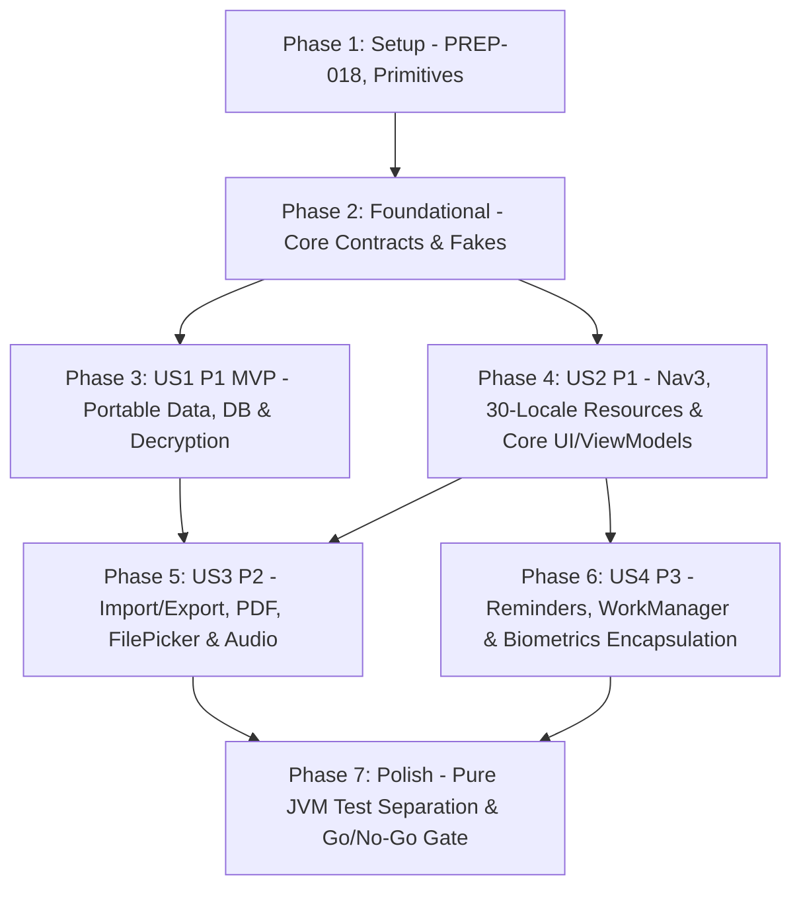

# Tasks: Multiplatform Migration Prerequisites (Android & Desktop Readiness)

**Input**: Design documents from `/specs/002-kmp-migration-prep/` (`spec.md`, `plan.md`, `research.md`, `data-model.md`, `contracts/platform-contracts.md`, `quickstart.md`) and [`docs/kmp-migration/`](../../docs/kmp-migration/README.md)

**Prerequisites**: `plan.md` (required), `spec.md` (required for user stories), `research.md`, `data-model.md`, `contracts/platform-contracts.md`

**Tests**: Included as specified by `FR-014`, `SC-002`, `SC-004`, and `PREP-010`/`PREP-012`/`PREP-017`/`PREP-020`/`PREP-021`.

**Organization**: Tasks are grouped by user story (`US1`–`US4`) and cross-referenced to `PREP-001` through `PREP-022` to enable independent implementation and verification of each increment.

## Format: `[ID] [P?] [Story] Description`

- **[P]**: Can run in parallel (different files, no dependencies on incomplete tasks)
- **[Story]**: Which user story this task belongs to (`[US1]`, `[US2]`, `[US3]`, `[US4]`)
- Exact repository-relative file paths are included in every task description

---

## Phase 1: Setup (Build Logic & Shared Core Primitives)

**Purpose**: Prepare Gradle convention plugins and foundational multiplatform-safe primitives (`PREP-018`, `PREP-020`)

- [X] T001 Extract reusable pure-Kotlin (JVM 17, ktfmt, serialization, Koin compiler) and Android convention plugins in `build-logic/build.gradle.kts`, `build-logic/src/main/kotlin/com/philkes/notallyx/buildlogic/`, and `app/build.gradle.kts` (`PREP-018`)
- [X] T002 Abstract `BuildConfig.VERSION_CODE` and `BuildConfig.VERSION_NAME` behind an `AppInfo` interface in `app/src/main/java/com/philkes/notallyx/core/platform/AppInfo.kt` and update `app/src/main/java/com/philkes/notallyx/core/common/extensions/LoggingExtensions.kt` (`PREP-018`)
- [X] T003 [P] Create multiplatform `Logger` facade and `ConverterErrorReporter` interface (removing `android.app.Dialog` coupling) in `app/src/main/java/com/philkes/notallyx/core/platform/Logger.kt` and `app/src/main/java/com/philkes/notallyx/core/database/ConverterErrorReporter.kt` (`PREP-020`)
- [X] T004 [P] Create `@JvmInline @Serializable value class PlatformUri(val uriString: String)` and static extension-to-MIME lookup utility in `app/src/main/java/com/philkes/notallyx/core/platform/PlatformUri.kt` and `app/src/main/java/com/philkes/notallyx/core/platform/MimeTypeUtils.kt` (`PREP-002`, `PREP-020`)

---

## Phase 2: Foundational (Core Platform Contracts & Test Harness)

**Purpose**: Core boundary contracts in `:shared` and `:composeApp` target packages that MUST be complete before user stories can be implemented (`PREP-001`, `PREP-004`, `PREP-006`, `PREP-010`, `PREP-017`, `PREP-019`)

**⚠️ CRITICAL**: No user story work can begin until this phase is complete

- [X] T005 [P] Create `PathProvider` interface with `AndroidPathProvider` (supporting `dataInPublicFolder`) and `DesktopPathProvider` (`$XDG_DATA_HOME/NotallyX` or `~/.local/share/NotallyX`, `~/Library/Application Support/NotallyX`, `%APPDATA%\NotallyX`) in `app/src/main/java/com/philkes/notallyx/core/platform/PathProvider.kt` (`PREP-006`)
- [X] T006 [P] Create `DatabaseDriverFactory` interface with Android driver factory and `BundledSQLiteDriver` JVM factory in `app/src/main/java/com/philkes/notallyx/core/database/DatabaseDriverFactory.kt` (`PREP-001`, `PREP-010`)
- [X] T007 [P] Create `FileStorage` interface and `AndroidFileStorage` implementation (confining `ContentResolver` and `DocumentFile` to Android) in `app/src/main/java/com/philkes/notallyx/core/platform/FileStorage.kt` (`PREP-004`)
- [X] T008 [P] Create `UiText` sealed interface (`DynamicString`, `Resource`, `PluralResource`) in `app/src/main/java/com/philkes/notallyx/core/ui/platform/UiText.kt` (`PREP-019`)
- [X] T009 Create pure-Kotlin test fakes (`FakePathProvider`, `FakeFileStorage`, `FakeDatabaseDriverFactory`) in `test-lib/src/main/java/com/philkes/notallyx/test/fakes/` (`PREP-017`)

**Checkpoint**: Foundation ready — user story implementation can now begin in parallel

---

## Phase 3: User Story 1 - Seamless Note & Attachment Portability Across Mobile and Desktop (Priority: P1) 🎯 MVP

**Goal**: Make all domain models, database type converters, Room 3 database creation/migrations, preferences, and legacy encrypted databases 100% portable across Android and Desktop JVM with zero data loss (`PREP-001`, `PREP-002`, `PREP-006`, `PREP-010`, `PREP-011`, `PREP-012`, `PREP-020`).

**Independent Test**: Run pure-JVM unit tests for `Converters` (v1–v11 JSON fixtures) and `NotallyDatabase` (`BundledSQLiteDriver` migrations v1→v11 and WAL checkpoint), plus the instrumented SQLCipher startup decryption test verifying 100% note/label/attachment preservation.

### Tests for User Story 1

- [X] T010 [P] [US1] Write `Converters` byte-compatibility round-trip and malformed-input fallback unit tests in `app/src/test/kotlin/com/philkes/notallyx/core/database/ConvertersTest.kt` (`PREP-020`)
- [X] T011 [P] [US1] Write pure-JVM Room 3 migration (v1→v11) and `checkpoint()` unit test using `BundledSQLiteDriver` without Robolectric in `app/src/test/kotlin/com/philkes/notallyx/core/database/NotallyDatabaseJvmTest.kt` (`PREP-001`, `PREP-010`)
- [X] T012 [P] [US1] Write instrumented startup decryption migration test for an encrypted v11 SQLCipher database fixture in `app/src/androidTest/java/com/philkes/notallyx/core/database/DatabaseDecryptionMigrationTest.kt` (`PREP-012`)

### Implementation for User Story 1

- [X] T013 [P] [US1] Remove `@Parcelize` and `android.os.Parcelable` from `@Serializable` models `Attachment`, `Audio`, `FileAttachment`, and `Reminder` (ensuring `FileAttachment.localName` and `Audio.name` store relative filenames) in `app/src/main/java/com/philkes/notallyx/data/model/Attachment.kt`, `app/src/main/java/com/philkes/notallyx/data/model/Audio.kt`, `app/src/main/java/com/philkes/notallyx/data/model/FileAttachment.kt`, and `app/src/main/java/com/philkes/notallyx/data/model/Reminder.kt` (`PREP-020`)
- [X] T014 [US1] Replace `org.json` (`JSONArray`, `JSONObject`) with `kotlinx.serialization.json` (`JsonElement`) in `app/src/main/java/com/philkes/notallyx/core/database/Converters.kt`, preserving exact JSON keys (`localName`, `originalName`, `mimeType`, `name`, `duration`, `timestamp`, `bold`, `link`, `linkData`, `italic`, `monospace`, `strikethrough`, `start`, `end`, `body`, `checked`, `isChild`, `order`, `children`, `id`, `dateTime`, `isNotificationVisible`, `repetition`) and reporting errors via `ConverterErrorReporter` (`PREP-020`)
- [X] T015 [US1] Replace `android.net.Uri`, `org.json`, `android.util.Base64`, and `android.text.Html` with `PlatformUri`, `kotlinx.serialization.json`, `kotlin.io.encoding.Base64`, and `jsoup` in `app/src/main/java/com/philkes/notallyx/data/model/extensions/ModelExtensions.kt` (`PREP-002`, `PREP-020`)
- [X] T016 [US1] Decouple `Context` and `ContextWrapper` from `NotallyDatabase`, `BackupSQLiteDriver`, `BackupOpenHelperFactory`, and `DataSchemaMigrations` using `PathProvider` and `DatabaseDriverFactory` with a single `DATABASE_VERSION = 11` constant in `app/src/main/java/com/philkes/notallyx/core/database/NotallyDatabase.kt`, `app/src/main/java/com/philkes/notallyx/core/database/BackupSQLiteDriver.kt`, `app/src/main/java/com/philkes/notallyx/core/database/BackupOpenHelperFactory.kt`, and `app/src/main/java/com/philkes/notallyx/core/database/DataSchemaMigrations.kt` (`PREP-001`, `PREP-010`)
- [X] T017 [P] [US1] Remove `Context`, `ContextWrapper`, and `android.util.Log` from `BaseNoteDao`, `CommonDao`, `DaoExtensions`, and `SearchResult` in `app/src/main/java/com/philkes/notallyx/data/dao/BaseNoteDao.kt`, `app/src/main/java/com/philkes/notallyx/data/dao/CommonDao.kt`, `app/src/main/java/com/philkes/notallyx/data/dao/DaoExtensions.kt`, and `app/src/main/java/com/philkes/notallyx/data/model/SearchResult.kt` (`PREP-001`, `PREP-020`)
- [X] T018 [P] [US1] Create `SecurePreferencesStore` interface, isolate Tink AEAD KeyStore binding to Android, and resolve DataStore paths via `PathProvider` in `app/src/main/java/com/philkes/notallyx/core/preference/SecurePreferencesStore.kt`, `app/src/main/java/com/philkes/notallyx/core/security/TinkAeadProvider.kt`, `app/src/main/java/com/philkes/notallyx/core/preference/NotallyXPreferences.kt`, and `app/src/main/java/com/philkes/notallyx/di/PreferencesModule.kt` (`PREP-006`, `PREP-011`)
- [X] T019 [US1] Define `const val FEATURE_FLAG_BIOMETRIC_ENCRYPTS_DB = false`, stop `DataSchemaMigrations` from enabling `biometricLockEncryptsDb`, hide the encryption toggle in Settings, and implement the non-destructive startup decryption migration (`pragma wal_checkpoint(TRUNCATE)` + SQLCipher export + atomic file swap + resetting `biometricLockEncryptsDb = false`) in `app/src/main/java/com/philkes/notallyx/core/database/NotallyDatabase.kt`, `app/src/main/java/com/philkes/notallyx/core/database/DataSchemaMigrations.kt`, `app/src/main/java/com/philkes/notallyx/core/security/EncryptionUtils.kt`, `app/src/main/java/com/philkes/notallyx/feature/migration/backup/DatabaseTransitionActivity.kt`, and `app/src/main/java/com/philkes/notallyx/feature/settings/SettingsScreen.kt` (`PREP-012`)
- [X] T020 [US1] Update Koin database and path provider bindings in `app/src/main/java/com/philkes/notallyx/di/DatabaseModule.kt` (`PREP-001`, `PREP-006`, `PREP-010`)

**Checkpoint**: User Story 1 is complete and independently verifiable — all data models, converters, database operations, and preferences are portable and free of Android framework coupling.

---

## Phase 4: User Story 2 - Uninterrupted Core Note-Taking, Navigation & Localization on Any Target (Priority: P1)

**Goal**: Make navigation state serialization, 30-locale localization resources, low-level UI components, date formatting, and core note/label ViewModels completely platform-independent (`PREP-003`, `PREP-007`, `PREP-008`, `PREP-009`, `PREP-019`, `PREP-021`).

**Independent Test**: Run pure-JVM unit tests for `NotallyNavKey` polymorphic serialization, `ReminderModelExtensions` formatting across locales, and core ViewModels (`LabelsViewModel`, `SelectLabelsViewModel`, `NotesRouteViewModel`), plus Roborazzi/Screenshot checks for 30 locales.

### Tests for User Story 2

- [X] T021 [P] [US2] Write pure-JVM polymorphic serialization unit test for all `NotallyNavKey` subtypes using `NotallyNavSavedStateConfig` in `app/src/test/kotlin/com/philkes/notallyx/navigation/NavigationStateSerializationTest.kt` (`PREP-021`)
- [X] T022 [P] [US2] Write pure-JVM unit tests for context-free relative date and reminder formatting across multiple locales in `app/src/test/kotlin/com/philkes/notallyx/data/model/extensions/ReminderModelExtensionsTest.kt` (`PREP-008`)

### Implementation for User Story 2

- [X] T023 [P] [US2] Configure `NotallyNavSavedStateConfig` registering all `NotallyNavKey` subtypes polymorphically and pass it to `rememberNavBackStack` in `app/src/main/java/com/philkes/notallyx/navigation/NavigationState.kt` and `app/src/main/java/com/philkes/notallyx/navigation/NotallyNavKey.kt` (`PREP-021`)
- [X] T024 [US2] Configure Compose Multiplatform Resources (`org.jetbrains.compose.resources`) in `app/build.gradle.kts`, migrate shared `values*/strings.xml` (30 locales) and shared vector drawables to `app/src/main/composeResources/`, and update `build-logic/src/main/kotlin/com/philkes/notallyx/buildlogic/LocalizationPlugin.kt` and `build-logic/src/main/kotlin/com/philkes/notallyx/buildlogic/tasks/GenerateLocalesPreviewTask.kt` (`PREP-019`)
- [X] T025 [P] [US2] Remove `android.content.Context` from date and reminder formatting functions in `app/src/main/java/com/philkes/notallyx/data/model/extensions/ReminderModelExtensions.kt` (`PREP-008`)
- [X] T026 [P] [US2] Remove `LocalContext.current` and `android.content.Context` imports from shared UI components and Skydoves ColorPicker dialogs in `app/src/main/java/com/philkes/notallyx/core/ui/components/BaseNoteCard.kt`, `app/src/main/java/com/philkes/notallyx/core/ui/dialog/color/ColorPickerControls.kt`, `app/src/main/java/com/philkes/notallyx/core/ui/dialog/color/ColorPickerDialog.kt`, `app/src/main/java/com/philkes/notallyx/feature/editor/screens/EditScreen.kt`, and `app/src/main/java/com/philkes/notallyx/core/ui/extensions/UiExtensions.kt` (`PREP-007`, `PREP-009`)
- [X] T027 [US2] Migrate `BaseViewModel`, `NoteModel`, `LabelsViewModel`, `SelectLabelsViewModel`, and `NotesRouteViewModel` from `AndroidViewModel`/`Application` to `androidx.lifecycle.ViewModel`, replace `android.database.sqlite.SQLiteConstraintException` with `androidx.sqlite.SQLiteException`, and replace `R.*`/`@StringRes` with `UiText`/`Res.*` in `app/src/main/java/com/philkes/notallyx/core/common/BaseViewModel.kt`, `app/src/main/java/com/philkes/notallyx/feature/editor/NoteModel.kt`, `app/src/main/java/com/philkes/notallyx/feature/labels/LabelsViewModel.kt`, `app/src/main/java/com/philkes/notallyx/feature/labels/SelectLabelsViewModel.kt`, and `app/src/main/java/com/philkes/notallyx/feature/main/routes/notes/NotesRouteViewModel.kt` (`PREP-003`, `PREP-019`, `PREP-020`)

**Checkpoint**: User Stories 1 and 2 are complete — core note-taking, navigation state, and 30-locale UI resources operate without Android framework dependencies.

---

## Phase 5: User Story 3 - Cross-Platform Import, Export, Sharing & Media Interactions (Priority: P2)

**Goal**: Abstract file selection (`FilePicker`), PDF export (`PdfExporter`), audio playback/recording (`AudioPlayer`/`AudioRecorder`), sharing (`ShareHandler`), and permissions (`PermissionChecker`), and remove all remaining Android imports from editor, media, and settings ViewModels (`PREP-002`, `PREP-003`, `PREP-004`, `PREP-005`, `PREP-014`, `PREP-022`).

**Independent Test**: Verify note imports (Google Keep, Evernote, JSON, Markdown, HTML, TXT), exports (PDF, HTML, ZIP backup), sharing, and audio playback/recording through the platform interfaces, and run editor/media/settings ViewModel unit tests in pure JVM mode.

### Implementation for User Story 3

- [X] T028 [P] [US3] Create `FilePicker` interface and `AndroidFilePicker` SAF implementation in `app/src/main/java/com/philkes/notallyx/core/ui/platform/FilePicker.kt` (`PREP-004`)
- [X] T029 [P] [US3] Create `PdfExporter` interface and `AndroidPdfExporter` implementation wrapping `android/print/PdfExtensions.kt` in `app/src/main/java/com/philkes/notallyx/feature/migration/backup/PdfExporter.kt`, `app/src/main/java/android/print/PdfExtensions.kt`, `app/src/main/java/com/philkes/notallyx/feature/migration/backup/NoteExportExtensions.kt`, and `app/src/main/java/com/philkes/notallyx/feature/editor/bottomsheet/ExportBottomSheet.kt` (`PREP-005`)
- [X] T030 [P] [US3] Create `ShareHandler` and `PermissionChecker` interfaces and Android implementations in `app/src/main/java/com/philkes/notallyx/core/ui/platform/ShareHandler.kt`, `app/src/main/java/com/philkes/notallyx/core/ui/platform/PermissionChecker.kt`, and `app/src/main/java/com/philkes/notallyx/core/common/extensions/AndroidExtensions.kt` (`PREP-022`)
- [X] T031 [P] [US3] Create `AudioPlayer` and `AudioRecorder` interfaces and Android service adapters in `app/src/main/java/com/philkes/notallyx/feature/media/audio/AudioPlayer.kt`, `app/src/main/java/com/philkes/notallyx/feature/media/audio/AudioRecorder.kt`, `app/src/main/java/com/philkes/notallyx/feature/media/audio/AudioPlayService.kt`, and `app/src/main/java/com/philkes/notallyx/feature/media/audio/AudioRecordService.kt` (`PREP-014`)
- [X] T032 [US3] Refactor `IOExtensions.kt`, `ImportExtensions.kt`, `ExportExtensions.kt`, and `EvernoteImporter.kt` to use `FileStorage`, `PathProvider`, `PlatformUri`, `kotlin.io.encoding.Base64`, and `MimeTypeUtils` in `app/src/main/java/com/philkes/notallyx/core/common/extensions/IOExtensions.kt`, `app/src/main/java/com/philkes/notallyx/feature/migration/backup/ImportExtensions.kt`, `app/src/main/java/com/philkes/notallyx/feature/migration/backup/ExportExtensions.kt`, and `app/src/main/java/com/philkes/notallyx/feature/migration/imports/evernote/EvernoteImporter.kt` (`PREP-004`, `PREP-020`)
- [X] T033 [US3] Refactor `EditNoteViewModel`, `EditListViewModel`, `EditTextPlainViewModel`, `PlayAudioViewModel`, `RecordAudioViewModel`, `ViewImageViewModel`, and `SettingsViewModel` (and corresponding routes `PlayAudioRoute.kt`, `ViewImageRoute.kt`, `SettingsRoute.kt`) to inject `FileStorage`, `PathProvider`, `PdfExporter`, `AudioPlayer`, `AudioRecorder`, `ShareHandler`, and `PermissionChecker` with zero `Application`, `android.net.Uri`, `PdfPrintListener`, `Intent`, `Manifest`, or `PackageManager` imports in `app/src/main/java/com/philkes/notallyx/feature/editor/EditNoteViewModel.kt`, `app/src/main/java/com/philkes/notallyx/feature/editor/EditListViewModel.kt`, `app/src/main/java/com/philkes/notallyx/feature/editor/EditTextPlainViewModel.kt`, `app/src/main/java/com/philkes/notallyx/feature/media/audio/PlayAudioViewModel.kt`, `app/src/main/java/com/philkes/notallyx/feature/media/audio/RecordAudioViewModel.kt`, `app/src/main/java/com/philkes/notallyx/feature/media/image/ViewImageViewModel.kt`, and `app/src/main/java/com/philkes/notallyx/feature/settings/SettingsViewModel.kt` (`PREP-002`, `PREP-003`, `PREP-005`, `PREP-014`, `PREP-022`)

**Checkpoint**: User Stories 1, 2, and 3 are complete — all import/export, PDF, file picker, sharing, and audio workflows operate through platform contracts.

---

## Phase 6: User Story 4 - Clean Encapsulation of Mobile-Only System Integrations (Priority: P3)

**Goal**: Encapsulate Android reminders/notifications (`ReminderScheduler`), background workers (`TaskScheduler`), and biometric app lock (`LockedActivity`/`BiometricAuthenticator`) behind platform boundaries with safe No-Op implementations for Desktop and JVM unit tests (`PREP-013`, `PREP-015`, `PREP-016`).

**Independent Test**: Verify `NoteRemindersViewModel` and background maintenance use cases (auto-backup, trashed note auto-removal, missing attachment cleanup) in pure JVM unit tests using `NoOpReminderScheduler` and `NoOpTaskScheduler` without WorkManager or AlarmManager.

### Implementation for User Story 4

- [X] T034 [P] [US4] Create `ReminderScheduler` interface with `AndroidReminderScheduler` (wrapping `AlarmManager`, `NotificationManager`, and `PinnedNotificationManager`) and `NoOpReminderScheduler` in `app/src/main/java/com/philkes/notallyx/feature/reminder/ReminderScheduler.kt`, `app/src/main/java/com/philkes/notallyx/feature/reminder/AlarmExtensions.kt`, and `app/src/main/java/com/philkes/notallyx/feature/reminder/PinnedNotificationManager.kt` (`PREP-013`)
- [X] T035 [US4] Refactor `NoteRemindersViewModel` to extend `androidx.lifecycle.ViewModel` and delegate exclusively to `ReminderScheduler` and `PermissionChecker` with zero `Application`, `AlarmManager`, or `Manifest` imports in `app/src/main/java/com/philkes/notallyx/feature/reminder/NoteRemindersViewModel.kt` (`PREP-003`, `PREP-013`, `PREP-022`)
- [X] T036 [P] [US4] Extract plain `suspend` use cases for periodic ZIP auto-backup, trashed-note auto-removal, and missing-attachment cleanup, and create `TaskScheduler` (`AndroidTaskScheduler` + `NoOpTaskScheduler`) in `app/src/main/java/com/philkes/notallyx/core/platform/TaskScheduler.kt`, `app/src/main/java/com/philkes/notallyx/feature/migration/backup/AutoBackupWorker.kt`, `app/src/main/java/com/philkes/notallyx/feature/migration/backup/CleanupMissingAttachmentsWorker.kt`, and `app/src/main/java/com/philkes/notallyx/feature/main/routes/settings/AutoRemoveDeletedNotesWorker.kt` (`PREP-015`)
- [X] T037 [US4] Isolate `BiometricAuthenticator`, `LockedActivity`, `LockUtils`, `MainActivityViewModel`, `EditActivityViewModel`, and `ErrorActivityViewModel` as Android-only entry components and wire all new platform interfaces in `app/src/main/java/com/philkes/notallyx/core/security/LockUtils.kt`, `app/src/main/java/com/philkes/notallyx/NotallyXApplication.kt`, `app/src/main/java/com/philkes/notallyx/di/AppModule.kt`, and `app/src/main/java/com/philkes/notallyx/di/FeatureModule.kt` (`PREP-003`, `PREP-015`, `PREP-016`)

**Checkpoint**: All four user stories (`US1`–`US4`) and `PREP-001` through `PREP-016`, `PREP-018` through `PREP-022` are complete.

---

## Phase 7: Polish & Cross-Cutting Concerns (Test Separation & Readiness Gate)

**Purpose**: Complete pure-JVM unit test separation (`PREP-017`), documentation updates, and the 13-item Go/No-Go readiness checklist (`CH-01`–`CH-13`)

- [X] T038 [P] Remove `@RunWith(RobolectricTestRunner::class)` and `ApplicationProvider` from domain, converter, and ViewModel unit tests in `app/src/test/kotlin/com/philkes/notallyx/` and separate pure-Kotlin fakes from Android `UiTestBase`/`UiUtils` in `test-lib/build.gradle.kts` and `test-lib/src/main/java/com/philkes/notallyx/test/` (`PREP-017`)
- [X] T039 [P] Update `AGENTS.md` (referencing `Res.string.*` for localization) and user documentation in `documentation/` for the database encryption sunset (`PREP-012`, `PREP-019`)
- [X] T040 Execute all validation scenarios in `specs/002-kmp-migration-prep/quickstart.md` (`./gradlew ktfmtCheck`, `./gradlew testDebugUnitTest`, `./gradlew verifyRoborazziDebug`, `./gradlew validateDebugScreenshotTest`, `./gradlew assembleDebug assembleBeta`, and static zero-Android-import audits) and check off `CH-01` through `CH-13` in `docs/kmp-migration/07-migration-readiness-checklist.md`

---

## Dependencies & Execution Order

### Phase Dependencies

- **Setup (Phase 1)**: No dependencies — can start immediately.
- **Foundational (Phase 2)**: Depends on Phase 1 completion — BLOCKS all user stories.
- **User Story 1 (Phase 3 - P1 🎯 MVP)**: Depends on Foundational (Phase 2). Delivers portable data, database, converters, and encryption sunset.
- **User Story 2 (Phase 4 - P1)**: Depends on Foundational (Phase 2) and integrates with US1 DAOs/models. Delivers portable navigation, 30-locale multiplatform resources, and core ViewModels.
- **User Story 3 (Phase 5 - P2)**: Depends on Foundational (Phase 2) and US1/US2 ViewModel/model foundations. Delivers cross-platform import/export, PDF, audio, file picker, and sharing abstractions.
- **User Story 4 (Phase 6 - P3)**: Depends on Foundational (Phase 2) and US2 ViewModel patterns. Encapsulates Android-only reminders, WorkManager tasks, and biometric lock.
- **Polish (Phase 7)**: Depends on all user stories (`US1`–`US4`) being complete.

### User Story Dependency Graph



### Parallel Opportunities

- **Phase 1**: `T003` (`Logger`/`ConverterErrorReporter`) and `T004` (`PlatformUri`/`MimeTypeUtils`) touch separate files and can run in parallel.
- **Phase 2**: `T005` (`PathProvider`), `T006` (`DatabaseDriverFactory`), `T007` (`FileStorage`), and `T008` (`UiText`) are independent interfaces in distinct files and can all be implemented in parallel.
- **Phase 3 (US1)**: Test tasks `T010`, `T011`, `T012` can be written in parallel; `T013` (de-parcelizing models), `T017` (DAO cleanup), and `T018` (`SecurePreferencesStore`) can run in parallel.
- **Phase 4 (US2)**: `T021` and `T022` tests can run in parallel; `T023` (`NavigationState`), `T025` (`ReminderModelExtensions`), and `T026` (UI component audit) touch independent packages and can run in parallel.
- **Phase 5 (US3)**: `T028` (`FilePicker`), `T029` (`PdfExporter`), `T030` (`ShareHandler`/`PermissionChecker`), and `T031` (`AudioPlayer`/`AudioRecorder`) can all be implemented in parallel before `T033` wires them into ViewModels.
- **Phase 6 (US4)**: `T034` (`ReminderScheduler`) and `T036` (`TaskScheduler` + backup/cleanup use cases) can run in parallel.

---

## Parallel Example: User Story 3 Platform Contracts

```bash
# All four platform boundary contracts in Phase 5 (US3) can be built simultaneously:
Task: "T028 [P] [US3] Create FilePicker interface and AndroidFilePicker SAF implementation in app/src/main/java/com/philkes/notallyx/core/ui/platform/FilePicker.kt"
Task: "T029 [P] [US3] Create PdfExporter interface and AndroidPdfExporter implementation in app/src/main/java/com/philkes/notallyx/feature/migration/backup/PdfExporter.kt"
Task: "T030 [P] [US3] Create ShareHandler and PermissionChecker interfaces in app/src/main/java/com/philkes/notallyx/core/ui/platform/ShareHandler.kt"
Task: "T031 [P] [US3] Create AudioPlayer and AudioRecorder interfaces in app/src/main/java/com/philkes/notallyx/feature/media/audio/AudioPlayer.kt"
```

---

## Implementation Strategy

### MVP First (User Story 1 Only)

1. Complete **Phase 1: Setup** (`T001`–`T004`).
2. Complete **Phase 2: Foundational** (`T005`–`T009`).
3. Complete **Phase 3: User Story 1** (`T010`–`T020`).
4. **STOP and VALIDATE**: Run `ConvertersTest`, `NotallyDatabaseJvmTest` (with `BundledSQLiteDriver`), and `DatabaseDecryptionMigrationTest`. At this point, the entire data & persistence layer (`:shared` core) is portable and verified.

### Incremental Delivery

1. **Foundation + US1 (Data & Persistence Portability)**: Models, `Converters`, Room 3 `NotallyDatabase`, `NotallyXPreferences`, and SQLCipher decryption migration ready.
2. **Add US2 (UI, Navigation & 30-Locale Resources Portability)**: Polymorphic `NotallyNavKey`, Compose Multiplatform `Res.*` + `UiText`, context-free UI components, and core ViewModels ready.
3. **Add US3 (File Picker, Import/Export, PDF & Media Abstractions)**: All editor, media, and settings ViewModels decoupled from Android `Uri`, `WebView`, `Intent`, and `Media3`.
4. **Add US4 (Android-Only System Encapsulation)**: `ReminderScheduler`, `TaskScheduler`, and `LockedActivity` cleanly isolated.
5. **Complete Phase 7 (Polish & Go/No-Go Gate)**: All unit tests run in pure JVM mode and all 13 `CH-*` readiness gates pass.
