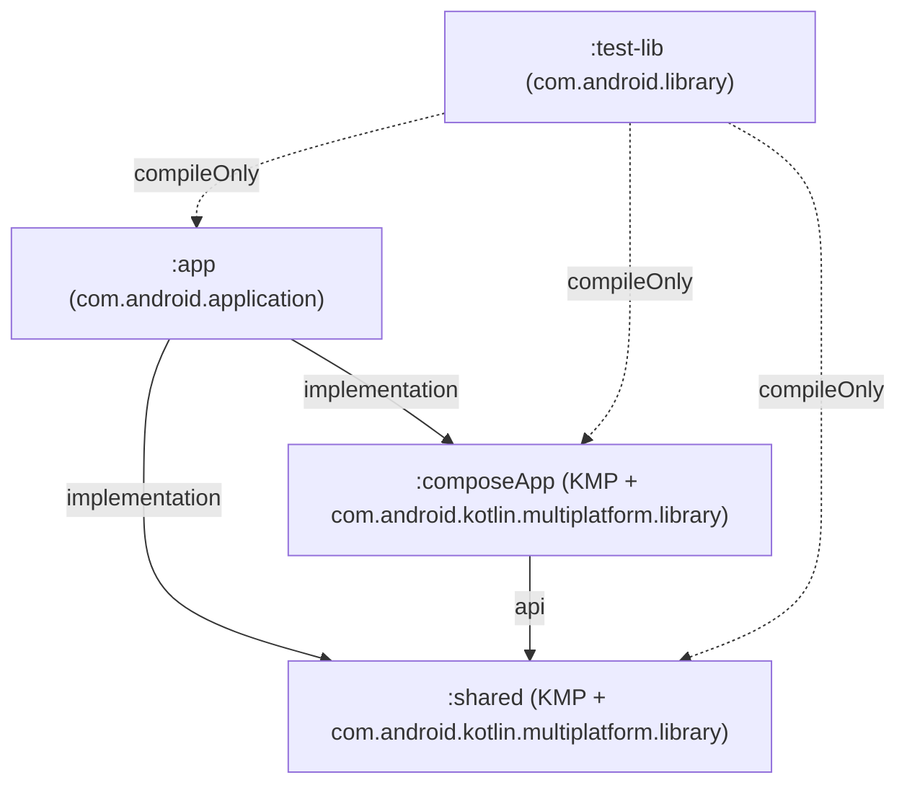

# Module & Build Boundary Contracts: Kotlin Multiplatform Project Migration (Android Target Only)

**Feature**: `003-kmp-android-migration` ([spec.md](../spec.md))  
**Date**: 2026-11-01  
**Status**: Completed  

---

## 1. Gradle Subproject Dependency Contract

The repository (`settings.gradle.kts`) exposes four Gradle subprojects (plus `build-logic` included build) governed by a strict acyclic dependency contract:



### Dependency Rules
1. **`:shared`** MUST NOT depend on `:composeApp` or `:app`.
2. **`:composeApp`** MUST depend on `:shared` (`api(project(":shared"))`) and MUST NOT depend on `:app`.
3. **`:app`** MUST depend on `:composeApp` and `:shared` and serves as the sole Android APK/AAB executable packaging module.
4. Neither `:shared` nor `:composeApp` may declare a `jvm("desktop")` target in this feature; only `kotlin { android { ... } }` is enabled (`FR-002`).

---

## 2. Source-Set Compilation & Import Contract (`FR-003`, `SC-001`)

| Module & Source Set | Directory Path | Allowed Platform Imports | Prohibited Imports |
| :--- | :--- | :--- | :--- |
| `:shared` (`commonMain`) | `shared/src/commonMain/kotlin` | `kotlin.*`, `kotlinx.*`, `java.io.*`, `java.nio.*`, `java.time.*`, `java.util.*`, `androidx.room3.*`, `androidx.sqlite.*`, `androidx.datastore.*`, `org.jsoup.*`, `net.lingala.zip4j.*`, `org.commonmark.*`, `org.ocpsoft.prettytime.*` | `android.*`, `com.philkes.notallyx.R`, `androidx.compose.*` |
| `:shared` (`androidMain`) | `shared/src/androidMain/kotlin`<br>`shared/src/androidMain/java`<br>`shared/src/androidMain/res` | All `commonMain` imports + `android.*`, `androidx.documentfile.*`, `com.google.crypto.tink.*`, `net.zetetic.database.sqlcipher.*`, `com.philkes.notallyx.R` | `androidx.compose.material3.*`, feature UI screens/routes |
| `:composeApp` (`commonMain`) | `composeApp/src/commonMain/kotlin` | `kotlin.*`, `kotlinx.*`, `androidx.compose.*`, `androidx.lifecycle.*`, `androidx.navigation3.*`, `androidx.savedstate.*`, `com.github.skydoves.colorpicker.compose.*`, `io.coil3.*`, `:shared` `commonMain` APIs | `android.*` |
| `:composeApp` (`androidMain`) | `composeApp/src/androidMain/kotlin` | All `commonMain` imports + `android.*`, `androidx.activity.compose.*`, `com.philkes.notallyx.R`, `:shared` `androidMain` APIs | `:app`-only classes (`MainActivity`, `NoteWidget`, `LockedActivity`, `WorkManager` workers) |
| `:app` (`main`) | `app/src/main/java` | All Android, Compose, Glance (`androidx.glance.*`), WorkManager (`androidx.work.*`), Media3 (`androidx.media3.*`), Biometric (`androidx.biometric.*`), `:composeApp`, and `:shared` APIs | N/A (Top-level host module) |

---

## 3. AGP 9.4.1 KMP Library Configuration Contract

### 3.1 `:shared/build.gradle.kts`
```kotlin
plugins {
    alias(libs.plugins.kotlin.multiplatform)
    alias(libs.plugins.android.kotlin.multiplatform.library)
    alias(libs.plugins.kotlin.serialization)
    alias(libs.plugins.ksp)
    alias(libs.plugins.ktfmt)
    alias(libs.plugins.koin.compiler)
    id("notallyx.kotlin.convention")
}

kotlin {
    android {
        namespace = "com.philkes.notallyx"
        compileSdk = libs.versions.compileSdk.get().toInt()
        minSdk = libs.versions.minSdk.get().toInt()
        withJava()
        androidResources {
            enable = true
        }
        withHostTest {
            isIncludeAndroidResources = true
        }
        compilerOptions {
            jvmTarget.set(org.jetbrains.kotlin.gradle.dsl.JvmTarget.JVM_17)
        }
    }
    // Only Android target enabled in 003-kmp-android-migration
}

ksp {
    arg("room.generateKotlin", "true")
    arg("room.schemaLocation", "$projectDir/schemas")
}
```

### 3.2 `:composeApp/build.gradle.kts`
```kotlin
plugins {
    alias(libs.plugins.kotlin.multiplatform)
    alias(libs.plugins.android.kotlin.multiplatform.library)
    alias(libs.plugins.kotlin.compose)
    alias(libs.plugins.kotlin.serialization)
    alias(libs.plugins.ktfmt)
    alias(libs.plugins.koin.compiler)
    id("notallyx.kotlin.convention")
    id("notallyx.android.localization")
}

kotlin {
    android {
        namespace = "com.philkes.notallyx.composeapp"
        compileSdk = libs.versions.compileSdk.get().toInt()
        minSdk = libs.versions.minSdk.get().toInt()
        androidResources {
            enable = true
        }
        withHostTest {
            isIncludeAndroidResources = true
        }
        compilerOptions {
            jvmTarget.set(org.jetbrains.kotlin.gradle.dsl.JvmTarget.JVM_17)
        }
    }
}
```

### 3.3 `:app/build.gradle.kts` Identity & Packaging Contract (`FR-009`)
- `namespace = "com.philkes.notallyx.app"`
- `defaultConfig.applicationId = "com.philkes.notallyx"`
- Build types preserved identically:
  - `debug`: `applicationIdSuffix = ".debug"`, `versionNameSuffix = "-DEBUG"`
  - `beta`: `applicationIdSuffix = ".beta"`, `versionNameSuffix = "-BETA"`
  - `release`: `isMinifyEnabled = true`, `isShrinkResources = true`, `proguard-rules.pro`

---

## 4. Cross-Module Koin DI Assembly Contract (`FR-008`)

1. **`:shared` (`com.philkes.notallyx.di`)**:
   - Exports `databaseModule` and `preferencesModule`.
2. **`:composeApp` (`com.philkes.notallyx.di`)**:
   - Exports `composeFeatureModule` registering shared feature ViewModels and `NoteModel`.
3. **`:app` (`com.philkes.notallyx.di.AppModule`)**:
   - Exports `platformModule` (binding `AppInfo`, `FileStorage`, `FilePicker`, `PdfExporter`, `AudioPlayer`, `AudioRecorder`, `ShareHandler`, `PermissionChecker`, `ReminderScheduler`, `TaskScheduler`), `androidHostModule` (binding `AutoRemoveDeletedNotesWorker`, `MainActivityViewModel`, `EditActivityViewModel`, `ErrorActivityViewModel`), and `appModules` combining all modules for `startKoin` in `NotallyXApplication`.
