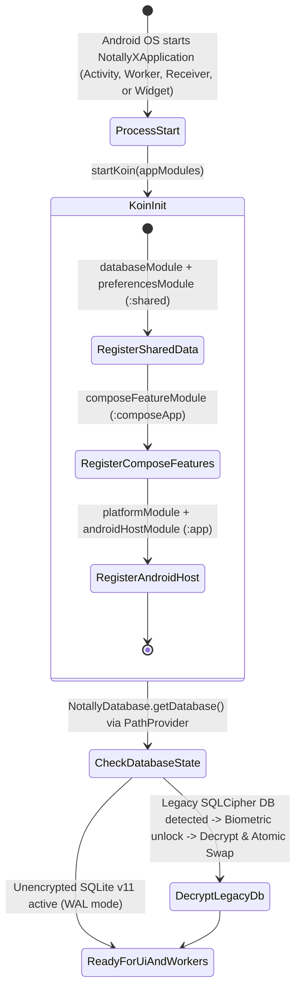

# Data & Module Ownership Model: Kotlin Multiplatform Project Migration (Android Target Only)

**Feature**: `003-kmp-android-migration` ([spec.md](spec.md))  
**Date**: 2026-11-01  
**Status**: Completed  

---

## 1. Overview

This document defines the module-level entity ownership, source-set partitioning (`commonMain` vs. `androidMain` vs. `:app`), database schema invariants, and dependency injection state lifecycle across `:shared`, `:composeApp`, `:app`, and `:test-lib`.

---

## 2. Module & Source-Set Entity Ownership Matrix

### 2.1 `:shared` Module (`shared/`) — Domain & Data Layer

| Entity / Package Group | Source Set | Key Types | Invariants & Validation Rules |
| :--- | :--- | :--- | :--- |
| **Core Domain Entities** (`com.philkes.notallyx.data.model`) | `commonMain` | `BaseNote`, `Label`, `Attachment`, `FileAttachment`, `Audio`, `Reminder`, `ListItem`, `SpanRepresentation`, `Color`, `ColorString`, `Folder`, `Type`, `NoteViewMode`, `SearchResult`, `Item`, `Header`, `LabelsInBaseNote` | 100% pure Kotlin + `@Serializable` + Room `@Entity`. Zero `android.*` or `R.*` imports (`NoteViewMode` decoupled from `StaticTextProvider`). |
| **Model & Reminder Extensions** (`com.philkes.notallyx.data.model.extensions`) | `commonMain` | `ModelExtensions.kt`, `ListItemExtensions.kt`, `ReminderModelExtensions.kt` | Uses `PlatformUri`, `kotlinx.serialization.json`, `kotlin.io.encoding.Base64`, `jsoup`, and `PrettyTime`. Zero `android.*` imports. |
| **Room 3 DAOs** (`com.philkes.notallyx.data.dao`) | `commonMain` | `BaseNoteDao`, `LabelDao`, `CommonDao`, `DaoExtensions` | Pure Room 3 suspend/Flow queries and `@Transaction` methods. Zero `Context` or `android.*` imports. |
| **Database Core & Converters** (`com.philkes.notallyx.core.database`) | `commonMain` | `Converters`, `ConverterErrorReporter`, `DatabaseDriverFactory` (interface + `JvmBundledDatabaseDriverFactory`), `DatabaseNotConnectedException`, `Migrations` (`Migration2`–`Migration11`) | Byte-compatible JSON serialization via `kotlinx.serialization.json`; Room 3 `SQLiteConnection` migrations (`DATABASE_VERSION = 11`). |
| **Android Database Runtime & SQLCipher Decryption** (`com.philkes.notallyx.core.database`, `core.security`) | `androidMain` | `NotallyDatabase` (with Android `ContextWrapper` lifecycle helpers), `AndroidDatabaseDriverFactory`, `BackupSQLiteDriver`, `BackupOpenHelperFactory`, `DataSchemaMigrations`, `EncryptionUtils`, `SQLCipherUtils`, `TinkAeadProvider` | Preserves `pragma wal_checkpoint(TRUNCATE)`, `FEATURE_FLAG_BIOMETRIC_ENCRYPTS_DB = false`, and one-time startup decryption migration. |
| **Platform Contracts & Portable Primitives** (`com.philkes.notallyx.core.platform`) | `commonMain` | `PathProvider` + `DesktopPathProvider`, `FileStorage`, `PlatformUri`, `MimeTypeUtils`, `Logger`, `AppInfo`, `TaskScheduler` + `NoOpTaskScheduler`, `ReminderScheduler` + `NoOpReminderScheduler`, `AudioPlayer` + `NoOpAudioPlayer`, `AudioRecorder` + `NoOpAudioRecorder`, `PdfExporter` | Pure Kotlin contracts with zero `android.*` imports. |
| **Android Data Platform Implementations** (`com.philkes.notallyx.core.platform`, `feature.migration.backup`) | `androidMain` | `AndroidPathProvider`, `AndroidFileStorage`, `AndroidPdfExporter`, `android/print/PdfExtensions.kt`, `AttachmentImportExtensions`, `AutoBackupExtensions`, `DatabaseBackupExtensions`, `ExportExtensions`, `ImportExtensions`, `NoteExportExtensions` | Confines `ContentResolver`, `DocumentFile`, `WebView`, and `PrintDocumentAdapter` to `androidMain`. |
| **Preferences & DataStore** (`com.philkes.notallyx.core.preference`) | `commonMain` & `androidMain` | `UserPreferences`, `SecurePreferences`, `SecurePreferencesStore` (`commonMain`); `NotallyXPreferences`, `AndroidSecurePreferencesStore`, `Preference`, `NotesSorting`, `LegacyNotallyXPreferences`, `SharedPreferences` migrations (`androidMain`) | Preserves JSON format for `notallyx_preferences.json` and Tink AEAD format for `notallyx_secure_preferences.bin`. |

---

### 2.2 `:composeApp` Module (`composeApp/`) — Presentation & Shared UI Layer

| Entity / Package Group | Source Set | Key Types | Invariants & Validation Rules |
| :--- | :--- | :--- | :--- |
| **Navigation 3 State & Routes** (`com.philkes.notallyx.navigation`) | `commonMain` | `NotallyNavKey`, `NavigationState`, `NotallyNavSavedStateConfig`, `Navigator`, `ListDetailScene`, `NavigationResults` | Explicit polymorphic `SavedStateConfiguration` for all 19 `NotallyNavKey` subtypes; zero `android.*` imports. |
| **Presentation Platform Contracts** (`com.philkes.notallyx.core.ui.platform`) | `commonMain` & `androidMain` | `FilePicker`, `ShareHandler`, `PermissionChecker`, `AppPermission` (`commonMain`); `AndroidFilePicker`, `AndroidShareHandler`, `AndroidPermissionChecker`, `UiText` (`androidMain`) | Decouples feature ViewModels from `ActivityResultLauncher`, `Intent`, `FileProvider`, and `PackageManager`. |
| **Shared UI Components, Dialogs & Theme** (`com.philkes.notallyx.core.ui`) | `commonMain` & `androidMain` | `BaseNoteCard`, `ReminderChip`, `LabelChip`, `ColorSwatchItem`, `ConfirmDialog`, `ErrorDialog`, `SelectionDialog`, `TextInputDialog`, `ColorPickerDialog`, `ColorPickerControls` | Composable UI components hoisted cleanly with Material 3 and Skydoves ColorPicker. |
| **Feature MVI Quads (18 Routes)** (`com.philkes.notallyx.feature.*`) | `commonMain` & `androidMain` | `labels` (`Labels*`, `SelectLabels*`), `editor` (`EditNote*`, `EditList*`, `EditTextPlain*`, `NoteModel`), `main` (`NotallyApp`, `MainScreen`, `Notes*`, `Archived*`, `Deleted*`, `Unlabeled*`, `DisplayLabel*`, `Search*`, `PickNote*`), `reminder` (`Reminders*`, `NoteReminders*`), `media` (`PlayAudio*`, `RecordAudio*`, `ViewImage*`), `settings` (`Settings*`) | Preserves strict 4-File Feature Quad (`Model.kt`, `ViewModel.kt`, `Screen.kt`, `Route.kt`) and unidirectional `onAction(Action)` flow. |

---

### 2.3 `:app` Module (`app/`) — Android Application Host Layer

| Entity / Package Group | Source Set | Key Types | Invariants & Validation Rules |
| :--- | :--- | :--- | :--- |
| **Application Bootstrap & Activities** (`com.philkes.notallyx`) | `main` | `NotallyXApplication`, `MainActivity`, `MainActivityViewModel`, `EditActivityViewModel`, `ErrorActivity`, `ErrorActivityViewModel`, `PidCrashDataCollector`, `DatabaseTransitionActivity`, `AndroidAppInfo` | Initializes Koin DI graph, crash handler (`CaocConfig`), theme/locale config, and hosts `NotallyApp()` Compose root. |
| **Biometric & PIN App Lock** (`com.philkes.notallyx.core.security`) | `main` | `LockedActivity`, `BiometricAuthenticator`, `SystemBiometricAuthenticator`, `AuthenticatorProvider`, `LockUtils`, `PhoneLockReceiver` | Android-only security gate protecting app entry and driving startup DB decryption when needed. |
| **Home Screen Widgets** (`com.philkes.notallyx.feature.widget`) | `main` | `NoteWidget`, `NoteWidgetReceiver`, `ConfigureWidgetActivity`, `ToggleChecklistAction` | Jetpack Glance app widgets isolated to Android application host. |
| **Background Workers, Alarms & Foreground Services** | `main` | `AutoBackupWorker`, `CleanupMissingAttachmentsWorker`, `CleanupMissingAttachmentsReceiver`, `AutoRemoveDeletedNotesWorker`, `AndroidTaskScheduler`, `ReminderReceiver`, `AndroidReminderScheduler`, `AlarmExtensions`, `PinnedNotificationManager`, `AudioPlayService`, `AudioRecordService`, `AndroidServiceAudioPlayer`, `AndroidServiceAudioRecorder` | Implements `TaskScheduler`, `ReminderScheduler`, `AudioPlayer`, and `AudioRecorder` using Android OS services. |

---

## 3. Cross-Module Dependency & DI Lifecycle State Machine

