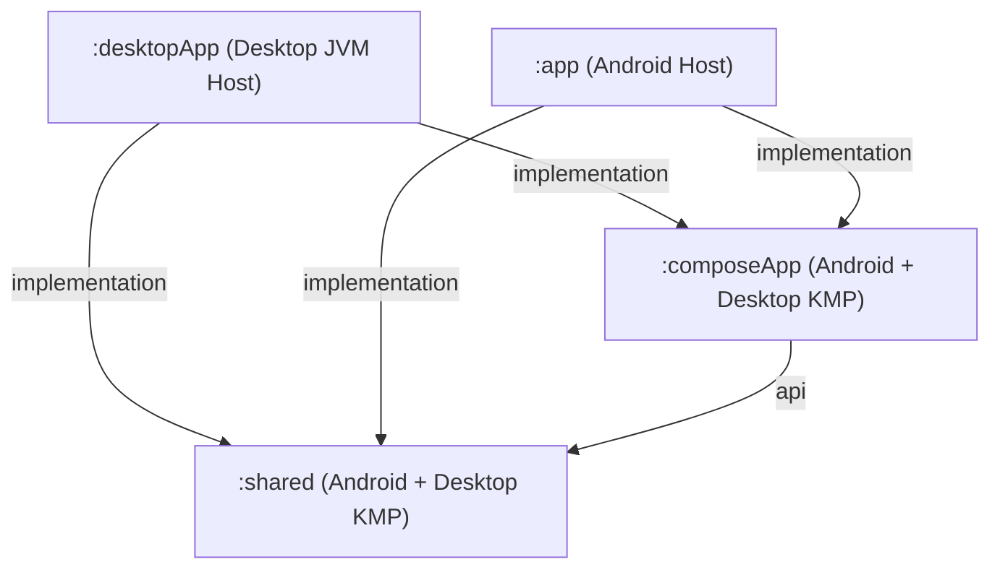

# Interface & Boundary Contracts: Desktop Target for Kotlin Multiplatform

**Feature**: `004-kmp-desktop-target` ([spec.md](../spec.md))  
**Date**: 2026-11-04  
**Status**: Completed  

---

## 1. Gradle Subproject Dependency Contract

The project structure adds `:desktopApp` as a sibling application module to `:app`:



### Dependency Rules
1. **`:desktopApp`** depends on `:composeApp` and `:shared`. It MUST NOT depend on `:app`.
2. **`:app`** depends on `:composeApp` and `:shared`. It MUST NOT depend on `:desktopApp`.
3. **`:composeApp`** depends on `:shared` via `api(project(":shared"))`. It MUST NOT depend on `:app` or `:desktopApp`.
4. **`:shared`** is the bottom-most leaf module and MUST NOT depend on `:composeApp`, `:app`, or `:desktopApp`.

---

## 2. Multiplatform Target Configuration Contract

### 2.1 `:shared/build.gradle.kts`
```kotlin
plugins {
    alias(libs.plugins.kotlin.multiplatform)
    alias(libs.plugins.android.kotlin.multiplatform.library)
    alias(libs.plugins.kotlin.serialization)
    alias(libs.plugins.ksp)
    alias(libs.plugins.ktfmt)
    alias(libs.plugins.koin.compiler)
    id("notallyx.kotlin.convention")
}

kotlin {
    android {
        namespace = "com.philkes.notallyx"
        compileSdk = libs.versions.compileSdk.get().toInt()
        minSdk = libs.versions.minSdk.get().toInt()
        withJava()
        androidResources { enable = true }
        withHostTest { isIncludeAndroidResources = true }
        compilerOptions { jvmTarget.set(org.jetbrains.kotlin.gradle.dsl.JvmTarget.JVM_17) }
    }
    
    jvm("desktop") {
        compilerOptions { jvmTarget.set(org.jetbrains.kotlin.gradle.dsl.JvmTarget.JVM_17) }
    }

    sourceSets {
        commonMain.dependencies {
            api(libs.androidx.room3.common)
            api(libs.androidx.room3.runtime)
            api(libs.sqlite.bundled)
            api(libs.kotlinx.serialization)
            api(project.dependencies.platform(libs.koin.bom))
            api(libs.koin.core)
            api(libs.jsoup)
            api(libs.prettytime)
            api(libs.simple.xml)
            api(libs.bundles.commonmark)
        }
        
        val desktopMain by getting {
            dependencies {
                // Desktop JVM specific dependencies
            }
        }
    }
}
```

### 2.2 `:desktopApp/build.gradle.kts` (New)
```kotlin
plugins {
    alias(libs.plugins.kotlin.multiplatform)
    alias(libs.plugins.kotlin.compose)
    alias(libs.plugins.ktfmt)
    alias(libs.plugins.koin.compiler)
    application
}

kotlin {
    jvm("desktop") {
        compilerOptions { jvmTarget.set(org.jetbrains.kotlin.gradle.dsl.JvmTarget.JVM_17) }
    }

    sourceSets {
        val desktopMain by getting {
            dependencies {
                implementation(project(":shared"))
                implementation(project(":composeApp"))
                implementation(libs.androidx.compose.ui)
                implementation(libs.androidx.compose.material3)
                implementation(libs.koin.core)
            }
        }
    }
}

application {
    mainClass.set("com.philkes.notallyx.desktop.MainKt")
}
```

---

## 3. Platform Abstraction & Dependency Injection Contract

All platform-specific facilities required by shared ViewModels and repositories MUST be satisfied via the established interface contracts registered in Koin:

| Contract Interface | Android Implementation (`:app` / `:shared:androidMain`) | Desktop Implementation (`:desktopApp` / `:shared:desktopMain`) |
| :--- | :--- | :--- |
| `DatabaseDriverFactory` | `AndroidDatabaseDriverFactory` (supports standard + encrypted DBs) | `DesktopDatabaseDriverFactory` (uses `BundledSQLiteDriver`) |
| `PathProvider` | `AndroidPathProvider` (maps to Android Context directories) | `DesktopPathProvider` (maps to OS standard app data directories) |
| `FileStorage` | `AndroidFileStorage` (supports `content://` and files) | `DesktopFileStorage` (standard JVM file I/O) |
| `FilePicker` | `AndroidFilePicker` (uses ActivityResult contracts) | `DesktopFilePicker` (standard desktop file dialog or file drag-drop) |
| `ShareHandler` | `AndroidShareHandler` (uses Android `ACTION_SEND` Intent) | `DesktopShareHandler` (system clipboard / email handler) |
| `PermissionChecker` | `AndroidPermissionChecker` (checks runtime Android permissions) | `DesktopPermissionChecker` (always returns `Granted`) |
| `TaskScheduler` | `AndroidTaskScheduler` (WorkManager) | `NoOpTaskScheduler` (no-op on desktop) |
| `ReminderScheduler` | `AndroidReminderScheduler` (AlarmManager) | `NoOpReminderScheduler` (no-op on desktop) |
| `AudioPlayer` | `AndroidServiceAudioPlayer` (Media3 service) | `NoOpAudioPlayer` (no-op in initial milestones) |
| `AudioRecorder` | `AndroidServiceAudioRecorder` (Media3 service) | `NoOpAudioRecorder` (no-op in initial milestones) |

---

## 4. Milestone Delivery Contract

### Milestone 1 Contract (Example Starter Screen)
- **Executable Target**: `./gradlew :desktopApp:run` compiles and launches the application window.
- **Screen Rendered**: `DesktopExampleScreen` displaying:
  - Welcome title and build/environment information (OS name, version, JVM runtime).
  - Verification badge confirming `:shared` and `:composeApp` dependency resolution.
  - Interactive counter or button confirming Compose event handling and state updates on desktop.
- **Window Behavior**: Window title set to "NotallyX", minimum size enforced (400x300), clean exit on close.

### Milestone 2 Contract (Core Note & Checklist Management)
- **Room Database Connectivity**: `NotallyDatabase` instantiated via `DesktopDatabaseDriverFactory` pointing to the user's desktop application directory.
- **Routes Enabled**:
  1. `NotesRoute` / `NotesScreen`: Lists notes, supports search and filtering.
  2. `EditNoteRoute` / `EditNoteScreen`: Full title, body, and formatting editing for text notes.
  3. `EditListRoute` / `EditListScreen`: Checkbox toggling, item addition, and editing for checklist notes.
- **Data Durability**: Automatic saving of edits to SQLite database; lossless persistence across restarts.

### Milestone 3 Contract (Full Route Parity)
- Remaining shared routes operational: `LabelsRoute`, `SearchRoute`, `ArchivedRoute`, `DeletedRoute`, `SettingsRoute`, and `ImportExportRoute`.
- Mobile-specific features (biometrics, widgets, Android notification channels) remain absent and non-invocable.
