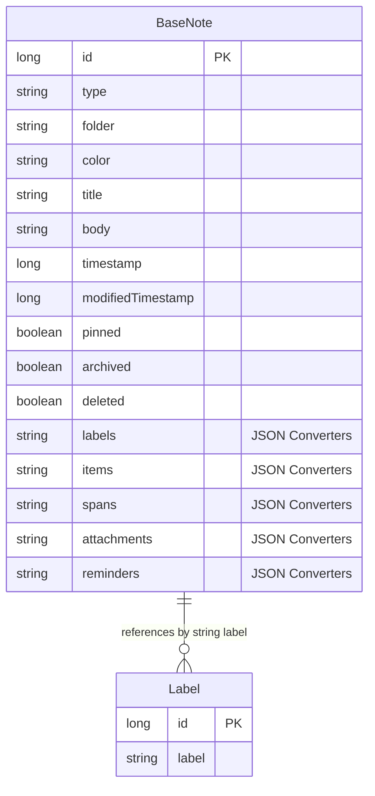
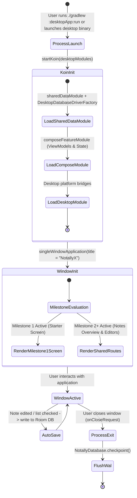

# Data & Module Ownership Model: Desktop Target for Kotlin Multiplatform

**Feature**: `004-kmp-desktop-target` ([spec.md](spec.md))  
**Date**: 2026-11-04  
**Status**: Completed  

---

## 1. Overview

This document specifies the module architecture, source-set partitioning, platform-specific entity mappings, and database compatibility invariants for supporting the Desktop (JVM) target alongside Android in NotallyX.

---

## 2. Module & Source-Set Entity Ownership Matrix

### 2.1 Four-Module Topology Overview

| Module | Gradle Plugin Configuration | Supported Targets | Primary Responsibility |
| :--- | :--- | :--- | :--- |
| **`:shared`** | `kotlin("multiplatform")` + `com.android.kotlin.multiplatform.library` + KSP | Android (`android`) + Desktop (`jvm("desktop")`) | Domain models, Room 3 database, DAOs, converters, migrations (v1–v11), preference models, import/export logic |
| **`:composeApp`** | `kotlin("multiplatform")` + `com.android.kotlin.multiplatform.library` + Compose | Android (`android`) + Desktop (`jvm("desktop")`) | Shared ViewModels, MVI models, Compose UI screens, dialogs, theming, Navigation 3 state |
| **`:app`** | `com.android.application` | Android only | Android application entry (`NotallyXApplication`), `MainActivity`, `LockedActivity`, Glance widgets, WorkManager workers, notification channels |
| **`:desktopApp`** | `kotlin("multiplatform")` (or `application`) + Compose Desktop | Desktop JVM only (`jvm("desktop")`) | Desktop application entry (`main()`), Compose desktop window harness, window menus, desktop Koin bootstrap |

---

### 2.2 Source-Set Entity Ownership

#### A. `:shared` Module
- **`src/commonMain`**:
  - Entities: `BaseNote`, `Label`, `Attachment`, `FileAttachment`, `Audio`, `Reminder`, `ListItem`, `SpanRepresentation`, `Color`, `Folder`, `Type`, `NoteViewMode`.
  - DAOs & Converters: `BaseNoteDao`, `LabelDao`, `CommonDao`, `Converters`, `ConverterErrorReporter`.
  - Platform Abstractions: `DatabaseDriverFactory`, `PathProvider`, `DesktopPathProvider`, `FileStorage`, `PlatformUri`, `Logger`, `AppInfo`, `TaskScheduler`, `ReminderScheduler`, `AudioPlayer`, `AudioRecorder`, `PdfExporter`.
  - Migrations: `Migration2` through `Migration11`, `ALL_MIGRATIONS`.
- **`src/desktopMain`**:
  - `DesktopDatabaseDriverFactory`: Implements `DatabaseDriverFactory` using `BundledSQLiteDriver` and `DesktopPathProvider`.
  - `DesktopFileStorage`: Portable JVM `java.io.File` / `java.nio.file.Path` storage implementation.
  - `DesktopLogger`: Standard console / file logging implementation.
- **`src/androidMain`**:
  - `AndroidDatabaseDriverFactory`, `AndroidPathProvider`, `AndroidFileStorage`, `AndroidLogger`, `BackupSQLiteDriver`, `TinkAeadProvider`, `EncryptionUtils`, `SQLCipherUtils`.

#### B. `:composeApp` Module
- **`src/commonMain`**:
  - Navigation: `NotallyNavKey`, `NavigationState`, `NotallyNavSavedStateConfig`, `Navigator`, `ListDetailScene`.
  - Platform Presentation Interfaces: `FilePicker`, `ShareHandler`, `PermissionChecker`, `AppPermission`.
  - Shared UI Components & Themes: `BaseNoteCard`, `LabelChip`, `ReminderChip`, `ColorSwatchItem`, `NotallyXTheme`, `Typography`, standard dialogs.
  - Core MVI Feature Quads (phased in M2 & M3): `EditNote*`, `EditList*`, `Notes*`, `Labels*`, `Search*`, etc.
- **`src/desktopMain`**:
  - Desktop-specific UI bridges: `DesktopFilePicker` (JFileChooser or native file dialog), `DesktopShareHandler` (system clipboard or desktop email client), `DesktopPermissionChecker` (always granted on desktop).
  - Milestone 1 verification screen: `DesktopExampleScreen.kt`.
- **`src/androidMain`**:
  - Android-specific UI bridges: `AndroidFilePicker`, `AndroidShareHandler`, `AndroidPermissionChecker`, `AndroidUiText`.

#### C. `:desktopApp` Module (New)
- **`src/desktopMain`** (or `jvmMain`):
  - `com.philkes.notallyx.desktop.Main.kt`: Main function with Compose `singleWindowApplication`.
  - `com.philkes.notallyx.desktop.di.DesktopModule.kt`: Desktop Koin module wiring desktop implementations of platform contracts.
  - `com.philkes.notallyx.desktop.DesktopAppInfo.kt`: Host system metadata (OS name, version, Java runtime).

---

## 3. Database Persistence & Room 3 Compatibility Invariants

### Invariants
1. **Identical SQLite Schema**: `NotallyDatabase` uses version `11` with tables `notes` and `labels`. Column definitions, types, default values, and indices are 100% byte-for-byte compatible between Android and Desktop.
2. **Identical Converters**: All complex fields (`labels`, `items`, `spans`, `attachments`, `reminders`) are serialized to SQLite `TEXT` columns using the exact same `Converters.kt` via `kotlinx.serialization.json`.
3. **Identical Migration Path**: Desktop uses `ALL_MIGRATIONS` (`Migration2` through `Migration11`). An older v1–v10 database opened on desktop undergoes the exact same migration pipeline as on Android.
4. **WAL Mode & Checkpointing**: `pragma wal_checkpoint(TRUNCATE)` is supported and executed on desktop via `NotallyDatabase.checkpoint()`.
5. **Storage Path Isolation**:
   - Android: `/data/user/0/com.philkes.notallyx/databases/NotallyDatabase`
   - Desktop: `~/.local/share/NotallyX/NotallyDatabase` (Linux), `~/Library/Application Support/NotallyX/NotallyDatabase` (macOS), `%APPDATA%\NotallyX\NotallyDatabase` (Windows).

---

## 4. Desktop Application Lifecycle & State Machine

