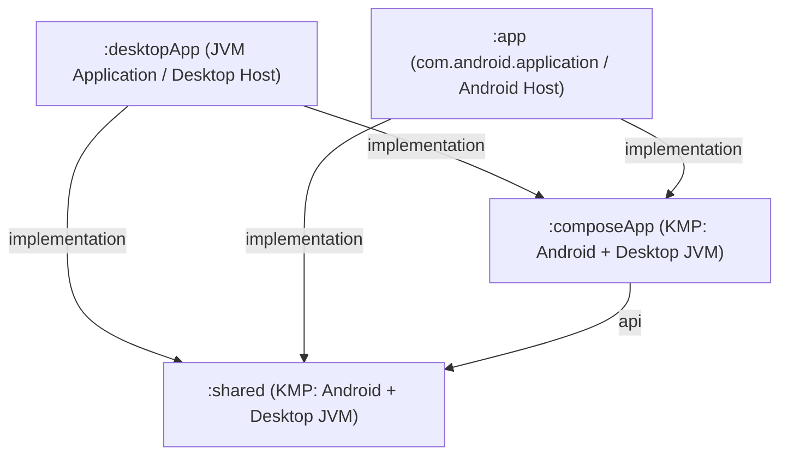

# Phase 0 Research: Desktop Target for Kotlin Multiplatform

**Feature**: `004-kmp-desktop-target` ([spec.md](spec.md))  
**Date**: 2026-11-04  
**Status**: Completed  

---

## 1. Desktop Project Architecture & Module Topology

### Decision
Introduce a dedicated desktop application host subproject, `:desktopApp`, alongside `:app` (Android application host), `:composeApp` (shared UI & presentation), and `:shared` (shared domain & data). Enable the `jvm("desktop")` target in `:shared` and `:composeApp` alongside existing `android { ... }` targets.

### Rationale
- **Separation of Concerns**: Mirroring `:app` for Android, `:desktopApp` acts strictly as the desktop runtime harness (window creation, desktop lifecycle, OS window frame, desktop entry point `main()`).
- **Maximum Code Sharing**: Core domain logic, DAOs, models, database converters, and migrations reside in `:shared/src/commonMain`. Shared UI screens, ViewModels, and navigation components reside in `:composeApp/src/commonMain` (or shared multiplatform source sets).
- **Zero Impact on Mobile**: `:app` remains completely unaffected in its packaging and release configuration.

### Alternatives Considered
- *Single Monolithic Module with Multi-Target in `:app`*: Rejected because AGP `com.android.application` cannot package a desktop JVM jar/executable; Android application plugins and desktop JVM packaging plugins conflict when placed in the same Gradle project.
- *Standalone Desktop Sub-repo*: Rejected because maintaining identical database schemas, models, and ViewModels across separate repositories causes divergence, sync friction, and violates the requirement to share as much code as possible with the Android app.

---

## 2. Desktop UI Framework: JetBrains Compose Multiplatform for Desktop

### Decision
Utilize Compose Multiplatform for Desktop (`org.jetbrains.compose`) with JVM 17 target for desktop rendering.

### Rationale
- **API Parity with Jetpack Compose**: Compose Multiplatform provides the same declarative Compose and Material 3 APIs (`androidx.compose.material3`, `Modifier`, `remember`, `LaunchedEffect`, etc.) used across the Android app.
- **Milestone 1 Velocity**: A starter screen can be run instantly using `singleWindowApplication` without needing complex Android Activity shims.
- **Progressive Sharing (Milestones 2 & 3)**: Shared screens (`EditScreen`, `MainScreen`, `NotesGridScreen`, etc.) can be rendered on desktop with minimal platform-specific branching.
- **Window Management**: Compose Multiplatform provides built-in desktop window features: window size, title, icon, minimum size, menu bars, and clean shutdown hooks.

### Alternatives Considered
- *JavaFX / TornadoFX*: Rejected because it requires completely rewriting all UI screens in a different framework, eliminating UI code sharing.
- *Swing*: Rejected for the same reason; completely incompatible with Compose UI code.

---

## 3. Database Persistence & Room 3 Compatibility on Desktop

### Decision
Use Room 3 (`androidx.room3:room3-runtime` + `androidx.sqlite:sqlite-bundled`) on the `desktop` JVM target with `BundledSQLiteDriver`, reusing the exact same entities (`BaseNote`, `Label`), DAOs (`BaseNoteDao`, `LabelDao`, `CommonDao`), converters (`Converters`), and migration history (v1 through v11).

### Rationale
- **Binary & Format Parity**: Room 3 on JVM using `sqlite-bundled` produces standard SQLite 3 database files with identical page sizing, journal/WAL modes, and schema structures. A database file copied from an Android device opens seamlessly on desktop and vice versa.
- **Verified Pure-JVM Execution**: The codebase already includes `NotallyDatabaseJvmTest.kt` in `shared/src/androidHostTest`, which proves that `NotallyDatabase` and all v1–v11 migrations compile and run cleanly on pure JVM with `BundledSQLiteDriver` without Android `Context` or Robolectric.
- **Storage Location**: Desktop databases are stored in the host OS's standard user data directory using `DesktopPathProvider` (already implemented in `PathProvider.kt`):
  - Linux: `~/.local/share/NotallyX/NotallyDatabase`
  - macOS: `~/Library/Application Support/NotallyX/NotallyDatabase`
  - Windows: `%APPDATA%\NotallyX\NotallyDatabase`

### Alternatives Considered
- *Exposed / SQLDelight*: Rejected because the user explicitly required using the exact same Room library and identical database format to avoid data migration bugs or maintaining two ORM implementations.
- *Flat-file JSON/Markdown notes on desktop*: Rejected because it breaks relational querying, labels, search performance, and bi-directional backup/sync with Android.

---

## 4. Phased Milestone Strategy

### Decision
Structure implementation into three clear milestones:

1. **Milestone 1 — Minimal Runnable Desktop Application**:
   - Establish `:desktopApp` subproject with `application` plugin and Compose Desktop plugin.
   - Configure `jvm("desktop")` target in `:shared` and `:composeApp`.
   - Implement desktop `main()` entry point launching a desktop window with an interactive example screen (confirming window lifecycle, theming, and responsive resizing).
2. **Milestone 2 — Core Notes & Checklist Management**:
   - Provide `DesktopDatabaseDriverFactory` and wire Koin for Desktop.
   - Promote core database definitions, `BaseNoteDao`, and primary ViewModels/Screens (Notes Overview, Edit Note, Edit Checklist) to shared source sets.
   - Implement full CRUD for notes and checklists with persistence in `~/.local/share/NotallyX/NotallyDatabase`.
3. **Milestone 3 — Comprehensive Route Parity & Mobile Feature Decoupling**:
   - Port remaining shared routes: Search, Labels, Archive, Trash, Settings, and Import/Export.
   - Ensure mobile-only capabilities (biometrics, system notifications, home screen widgets) remain strictly isolated to `:app` and are omitted from desktop.

### Rationale
- **Risk Mitigation**: Ensures the desktop build chain, Gradle plugins, and basic windowing work before touching shared ViewModel or Room dependencies.
- **Iterative Deliverables**: Each milestone delivers an independently verifiable product slice aligned with user stories.

---

## 5. Scope Boundary: Mobile-Only Feature Exclusion

### Decision
Explicitly omit and isolate the following Android-specific subsystems from the desktop target:
- **Biometric App Lock & `LockedActivity`**: Desktop environments do not have standardized biometric prompt APIs. Notes will not require biometric unlock on desktop in this phase.
- **Android Notifications & Reminder Alarms**: Android `AlarmManager` and `NotificationManager` are mobile OS services. Reminders will display in the UI as chips/dates, but background scheduled push notifications are excluded.
- **Home Screen Widgets (`Glance`)**: Android AppWidgets are mobile-specific; excluded from desktop.
- **Audio Recording Service**: Audio playback can be supported via standard JVM media libraries if needed in future milestones, but foreground audio recording services are excluded.

---

## 6. Dependency Injection & Configuration on Desktop

### Decision
Use Koin 4.x (`koin-core` and Koin Compose) for Desktop dependency injection, defining a `desktopModule` in `:desktopApp` that provides:
- `DatabaseDriverFactory` → `DesktopDatabaseDriverFactory`
- `PathProvider` → `DesktopPathProvider`
- `FileStorage` → `DesktopFileStorage`
- `TaskScheduler` → `NoOpTaskScheduler`
- `AudioPlayer` / `AudioRecorder` → `NoOpAudioPlayer` / `NoOpAudioRecorder`

### Rationale
- Koin 4 is already the standard DI framework across the project.
- Replaces Android platform-specific implementations with desktop-safe implementations via clean interface contracts without touching business logic.
