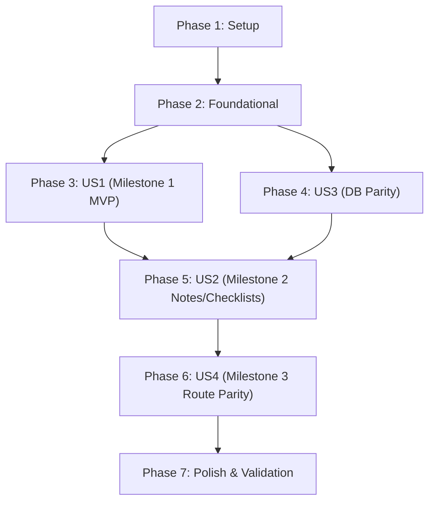

# Tasks: Desktop Target for Kotlin Multiplatform

**Input**: Design documents from `/specs/004-kmp-desktop-target/`  
**Prerequisites**: [plan.md](file:///home/user/AndroidStudioProjects/NotallyX/specs/004-kmp-desktop-target/plan.md) (required), [spec.md](file:///home/user/AndroidStudioProjects/NotallyX/specs/004-kmp-desktop-target/spec.md) (required for user stories), [research.md](file:///home/user/AndroidStudioProjects/NotallyX/specs/004-kmp-desktop-target/research.md), [data-model.md](file:///home/user/AndroidStudioProjects/NotallyX/specs/004-kmp-desktop-target/data-model.md), [contracts/desktop-contracts.md](file:///home/user/AndroidStudioProjects/NotallyX/specs/004-kmp-desktop-target/contracts/desktop-contracts.md), [quickstart.md](file:///home/user/AndroidStudioProjects/NotallyX/specs/004-kmp-desktop-target/quickstart.md)

**Tests**: Unit tests for desktop database operations and build verification tasks are included across `:shared` and `:desktopApp` to ensure binary compatibility and stability (`SC-001`–`SC-006`).

**Organization**: Tasks are grouped by phase and user story (`US1` → `US3` → `US2` → `US4`), aligning with the 3 delivery milestones:
- **Milestone 1**: Phase 1 (Setup), Phase 2 (Foundational), Phase 3 (US1 - Runnable Starter Screen) 🎯 MVP
- **Milestone 2**: Phase 4 (US3 - Room DB Parity), Phase 5 (US2 - Core Note & Checklist Management)
- **Milestone 3**: Phase 6 (US4 - Full Route Parity & Mobile Feature Decoupling), Phase 7 (Polish)

## Format: `[ID] [P?] [Story] Description`

- **[P]**: Can run in parallel (different files, no dependencies on incomplete tasks)
- **[Story]**: Which user story this task belongs to (`[US1]`, `[US2]`, `[US3]`, `[US4]`)
- Exact file paths are included in every task description

## Path Conventions

- **`:shared` KMP Domain & Data Module**: `shared/src/commonMain/kotlin/`, `shared/src/desktopMain/kotlin/`, `shared/src/androidMain/kotlin/`, `shared/src/desktopTest/kotlin/`, `shared/schemas/`
- **`:composeApp` KMP Presentation & UI Module**: `composeApp/src/commonMain/kotlin/`, `composeApp/src/desktopMain/kotlin/`, `composeApp/src/androidMain/kotlin/`
- **`:desktopApp` Desktop Application Host Module**: `desktopApp/src/desktopMain/kotlin/com/philkes/notallyx/desktop/`
- **`:app` Android Application Host Module**: `app/src/main/java/` (preserved without breaking changes)
- **`:build-logic` Gradle Convention Plugins**: `build-logic/convention/src/main/kotlin/`

---

## Phase 1: Setup (Gradle Catalog, Subproject Registration & Desktop Target Setup)

**Purpose**: Configure Compose Desktop dependencies in the version catalog, register `:desktopApp` in Gradle settings, update `:build-logic` convention plugins to support the desktop JVM target, and add `jvm("desktop")` target definitions to `:shared` and `:composeApp`.

- [ ] T001 Register Compose Multiplatform Desktop plugins and library aliases in `gradle/libs.versions.toml`
- [ ] T002 Include `:desktopApp` subproject alongside `:shared`, `:composeApp`, `:app`, and `:test-lib` in `settings.gradle.kts`
- [ ] T003 [P] Update `NotallyxKotlinConventionPlugin` to support the `desktop` JVM target (JVM 17) and ktfmt configuration for desktop source sets in `build-logic/src/main/kotlin/com/philkes/notallyx/buildlogic/convention/NotallyxKotlinConventionPlugin.kt`
- [ ] T004 [P] Add `jvm("desktop")` target and `desktopMain` source set definition to `shared/build.gradle.kts`
- [ ] T005 [P] Add `jvm("desktop")` target and `desktopMain` source set definition to `composeApp/build.gradle.kts`
- [ ] T006 Create `:desktopApp` subproject build configuration with `kotlin.multiplatform`, `application`, and Compose Desktop in `desktopApp/build.gradle.kts`

---

## Phase 2: Foundational (Desktop Platform Abstractions & DI Module)

**Purpose**: Implement desktop platform contracts and dependency injection wiring required by all desktop user stories.

**⚠️ CRITICAL**: Must complete before implementing any user story to provide non-Android implementations of platform contracts.

- [ ] T007 [P] Implement `DesktopFileStorage` using standard JVM `java.io.File` and `java.nio.file.Path` in `shared/src/desktopMain/kotlin/com/philkes/notallyx/core/platform/DesktopFileStorage.kt`
- [ ] T008 [P] Implement `DesktopLogger` printing to standard console and application logs in `shared/src/desktopMain/kotlin/com/philkes/notallyx/core/platform/DesktopLogger.kt`
- [ ] T009 [P] Implement `DesktopAppInfo` reporting host OS name, OS version, and JVM runtime metadata in `desktopApp/src/desktopMain/kotlin/com/philkes/notallyx/desktop/DesktopAppInfo.kt`
- [ ] T010 [P] Implement `DesktopFilePicker` using desktop dialogs / file choosers in `composeApp/src/desktopMain/kotlin/com/philkes/notallyx/core/ui/platform/DesktopFilePicker.kt`
- [ ] T011 [P] Implement `DesktopShareHandler` utilizing system clipboard or desktop mail client in `composeApp/src/desktopMain/kotlin/com/philkes/notallyx/core/ui/platform/DesktopShareHandler.kt`
- [ ] T012 [P] Implement `DesktopPermissionChecker` returning Granted for all permission requests in `composeApp/src/desktopMain/kotlin/com/philkes/notallyx/core/ui/platform/DesktopPermissionChecker.kt`
- [ ] T013 Configure desktop Koin dependency injection module wiring desktop platform implementations in `desktopApp/src/desktopMain/kotlin/com/philkes/notallyx/desktop/di/DesktopModule.kt`

**Checkpoint**: Foundation ready — desktop platform bridges and DI are compiled and ready for User Story 1.

---

## Phase 3: User Story 1 - Desktop Application Launch and Baseline Screen (Milestone 1) (Priority: P1) 🎯 MVP

**Goal**: Deliver a runnable desktop application window running via Compose Multiplatform for Desktop with an interactive example starter screen verifying application bootstrap, diagnostics, input handling, and clean shutdown.

**Independent Test**: Execute `./gradlew :desktopApp:run` and verify that a desktop window titled "NotallyX" appears within 2.0 seconds, renders `DesktopExampleScreen`, responds to window resizing, increments a counter on interaction, and exits cleanly when closed.

### Implementation for User Story 1

- [ ] T014 [P] [US1] Create `DesktopExampleScreen.kt` with header, diagnostic environment information from `DesktopAppInfo`, and an interactive counter button in `composeApp/src/desktopMain/kotlin/com/philkes/notallyx/core/ui/screens/DesktopExampleScreen.kt`
- [ ] T015 [US1] Implement desktop entry point `main()` initializing Koin and launching `singleWindowApplication` with `NotallyXTheme` and `DesktopExampleScreen` in `desktopApp/src/desktopMain/kotlin/com/philkes/notallyx/desktop/Main.kt`
- [ ] T016 [US1] Add window lifecycle handlers (`onCloseRequest`, minimum window dimensions 400x300, window title "NotallyX") in `desktopApp/src/desktopMain/kotlin/com/philkes/notallyx/desktop/Main.kt`
- [ ] T017 [US1] Add desktop run configuration and build verification task in `desktopApp/build.gradle.kts` and verify `./gradlew :desktopApp:assemble` succeeds

**Checkpoint**: Milestone 1 (MVP) is fully functional and independently runnable via `./gradlew :desktopApp:run`.

---

## Phase 4: User Story 3 - Full Data Parity and Storage Compatibility (Priority: P2)

**Goal**: Enable Room 3 `NotallyDatabase` on desktop JVM with `BundledSQLiteDriver`, reusing identical entities, DAOs, converters, and migrations (v1–v11) to guarantee 100% binary compatibility with Android databases.

**Independent Test**: Run pure-JVM unit tests via `./gradlew :shared:testAndroidHostTest --tests "com.philkes.notallyx.core.database.NotallyDatabaseJvmTest"` and verify that database instances initialize, migrate, and ping successfully.

### Implementation for User Story 3

- [ ] T018 [P] [US3] Implement `DesktopDatabaseDriverFactory` implementing `DatabaseDriverFactory` with `BundledSQLiteDriver` and `DesktopPathProvider` in `shared/src/desktopMain/kotlin/com/philkes/notallyx/core/database/DesktopDatabaseDriverFactory.kt`
- [ ] T019 [US3] Decouple `NotallyDatabase` companion object and builder from Android `ContextWrapper` so `createDatabase(driverFactory)` is directly callable on pure desktop JVM in `shared/src/androidMain/kotlin/com/philkes/notallyx/core/database/NotallyDatabase.kt`
- [ ] T020 [P] [US3] Add pure-JVM database test verifying in-memory and file-based CRUD, checkpointing, and v1–v11 migrations in `shared/src/desktopTest/kotlin/com/philkes/notallyx/core/database/DesktopDatabaseTest.kt`
- [ ] T021 [US3] Wire `DesktopDatabaseDriverFactory` into the desktop DI graph in `desktopApp/src/desktopMain/kotlin/com/philkes/notallyx/desktop/di/DesktopModule.kt`

**Checkpoint**: Database parity is complete and verified — desktop reads and writes identical SQLite databases as Android.

---

## Phase 5: User Story 2 - Primary Note and Checklist Management (Milestone 2) (Priority: P2)

**Goal**: Deliver core note management on desktop: Notes Overview, Text Note Editor, and Checklist Note Editor backed by the shared Room database, with automatic persistence and responsive desktop layout.

**Independent Test**: Launch `./gradlew :desktopApp:run`, create and edit text notes and checklists, verify changes appear in overview and persist across application restarts.

### Implementation for User Story 2

- [ ] T022 [P] [US2] Move shared note card components (`BaseNoteCard.kt`, `LabelChip.kt`, `ReminderChip.kt`, `ColorSwatchItem.kt`) from `composeApp/src/androidMain/` to `composeApp/src/commonMain/kotlin/com/philkes/notallyx/core/ui/components/`
- [ ] T023 [P] [US2] Move shared note editing dialogs (`ConfirmDialog.kt`, `ErrorDialog.kt`, `TextInputDialog.kt`, `ColorPickerDialog.kt`) from `composeApp/src/androidMain/` to `composeApp/src/commonMain/kotlin/com/philkes/notallyx/core/ui/dialog/`
- [ ] T024 [P] [US2] Move `NotesModel.kt`, `EditNoteModel.kt`, and `EditListModel.kt` from `composeApp/src/androidMain/` to `composeApp/src/commonMain/kotlin/com/philkes/notallyx/feature/editor/` and `composeApp/src/commonMain/kotlin/com/philkes/notallyx/feature/main/routes/notes/`
- [ ] T025 [P] [US2] Move `NotesScreen.kt`, `EditScreen.kt`, and `ChecklistItemRow.kt` from `composeApp/src/androidMain/` to `composeApp/src/commonMain/kotlin/com/philkes/notallyx/feature/main/routes/notes/` and `composeApp/src/commonMain/kotlin/com/philkes/notallyx/feature/editor/screens/`
- [ ] T026 [US2] Create desktop navigation coordinator hosting `NotesRoute`, `EditNoteRoute`, and `EditListRoute` in `desktopApp/src/desktopMain/kotlin/com/philkes/notallyx/desktop/DesktopAppNavHost.kt`
- [ ] T027 [US2] Update `Main.kt` in `:desktopApp` to switch from Milestone 1 example screen to `DesktopAppNavHost` in `desktopApp/src/desktopMain/kotlin/com/philkes/notallyx/desktop/Main.kt`
- [ ] T028 [US2] Add automatic WAL checkpointing on desktop window close (`onCloseRequest`) via `NotallyDatabase.checkpoint()` in `desktopApp/src/desktopMain/kotlin/com/philkes/notallyx/desktop/Main.kt`

**Checkpoint**: Milestone 2 is complete — desktop users can view, create, edit, check, and persist notes and checklists locally.

---

## Phase 6: User Story 4 - Comprehensive Route Parity with Mobile-Only Feature Exclusion (Milestone 3) (Priority: P3)

**Goal**: Port remaining shared routes (Search, Labels, Archive, Trash, Settings, Import/Export) to desktop, while cleanly isolating and omitting mobile-only hardware subsystems (biometrics, mobile notifications, home screen widgets).

**Independent Test**: Navigate through all secondary shared routes on desktop, confirming search queries filter notes accurately, labels can be created and assigned, and no mobile-specific prompts or errors appear.

### Implementation for User Story 4

- [ ] T029 [P] [US4] Move `SearchModel.kt`, `SearchScreen.kt`, `SearchViewModel.kt`, and `SearchRoute.kt` to `composeApp/src/commonMain/kotlin/com/philkes/notallyx/feature/main/routes/search/`
- [ ] T030 [P] [US4] Move `LabelsModel.kt`, `LabelsScreen.kt`, `LabelsViewModel.kt`, and `LabelsRoute.kt` to `composeApp/src/commonMain/kotlin/com/philkes/notallyx/feature/labels/`
- [ ] T031 [P] [US4] Move `ArchivedModel.kt`, `ArchivedScreen.kt`, `DeletedModel.kt`, and `DeletedScreen.kt` to `composeApp/src/commonMain/kotlin/com/philkes/notallyx/feature/main/routes/archived/` and `composeApp/src/commonMain/kotlin/com/philkes/notallyx/feature/main/routes/deleted/`
- [ ] T032 [P] [US4] Move shared settings UI components and import/export flows to `composeApp/src/commonMain/kotlin/com/philkes/notallyx/feature/main/routes/settings/`
- [ ] T033 [US4] Conditionally hide mobile-specific preference categories (Biometric Lock, Home Screen Widgets, Status Bar Pinned Notifications) when running on desktop in `composeApp/src/commonMain/kotlin/com/philkes/notallyx/feature/main/routes/settings/SettingsRoute.kt`
- [ ] T034 [US4] Register all remaining shared routes in `DesktopAppNavHost.kt` in `desktopApp/src/desktopMain/kotlin/com/philkes/notallyx/desktop/DesktopAppNavHost.kt`

**Checkpoint**: Milestone 3 is complete — desktop target reaches full route parity with mobile-only capabilities cleanly decoupled.

---

## Phase 7: Polish & Cross-Cutting Concerns

**Purpose**: Static audits, code formatting, end-to-end quickstart validation, and documentation updates.

- [ ] T035 [P] Run static audit ensuring zero `android.*` imports in `desktopApp/` and `desktopMain/` directories
- [ ] T036 Run `./gradlew ktfmtCheck` and apply formatting via `./gradlew ktfmtFormat` across all subprojects
- [ ] T037 Execute automated quickstart verification scenarios from `specs/004-kmp-desktop-target/quickstart.md`
- [ ] T038 [P] Update architecture and desktop developer setup documentation in `documentation/docs/architecture/kmp-desktop.md`

---

## Dependencies & Execution Order

### Phase Dependencies

- **Setup (Phase 1)**: No dependencies — can start immediately.
- **Foundational (Phase 2)**: Depends on Phase 1 completion — BLOCKS all user story phases.
- **User Story 1 (Phase 3 - Milestone 1)**: Depends on Phase 2 completion — delivers runnable desktop MVP.
- **User Story 3 (Phase 4 - Data Parity)**: Depends on Phase 2 completion — can proceed after US1 to establish desktop database persistence.
- **User Story 2 (Phase 5 - Milestone 2)**: Depends on Phase 3 (US1 window) and Phase 4 (US3 database persistence).
- **User Story 4 (Phase 6 - Milestone 3)**: Depends on Phase 5 (US2 navigation host & core routes).
- **Polish (Phase 7)**: Depends on completion of all desired user stories.

---

## Parallel Opportunities

- **Phase 1 (Setup)**: Tasks `T003`, `T004`, `T005` can run in parallel once `T001` and `T002` are complete.
- **Phase 2 (Foundational)**: Platform implementation tasks `T007`, `T008`, `T009`, `T010`, `T011`, `T012` can all run in parallel.
- **Phase 3 (User Story 1)**: Starter screen creation (`T014`) can run in parallel with window configuration (`T016`).
- **Phase 4 (User Story 3)**: `DesktopDatabaseDriverFactory` (`T018`) and `DesktopDatabaseTest` (`T020`) can run in parallel.
- **Phase 5 (User Story 2)**: Component migration tasks `T022`, `T023`, `T024`, `T025` can all run in parallel.
- **Phase 6 (User Story 4)**: Secondary route migration tasks `T029`, `T030`, `T031`, `T032` can all run in parallel.

---

## Implementation Strategy

### MVP First (Milestone 1: User Story 1 Only)

1. Complete **Phase 1: Setup** (configure catalog, subproject, and convention plugins).
2. Complete **Phase 2: Foundational** (desktop platform implementations & DI).
3. Complete **Phase 3: User Story 1** (interactive starter screen in `:desktopApp`).
4. **STOP and VALIDATE**: Run `./gradlew :desktopApp:run` to verify desktop window creation, rendering, and interaction.
5. This delivers the first requested milestone: a plain example, runnable desktop target with an example screen!

### Incremental Milestone Progression

1. **Milestone 1 (MVP)**: Phase 1 + Phase 2 + Phase 3 → Runnable desktop target with example screen.
2. **Milestone 2**: Phase 4 (US3 Room DB) + Phase 5 (US2 Core Notes/Checklists) → Fully functional note-taking app on desktop with shared SQLite database.
3. **Milestone 3**: Phase 6 (US4 Route Parity) + Phase 7 (Polish) → Complete route parity across Search, Labels, Archive, Trash, and Settings with mobile-only features cleanly decoupled.
