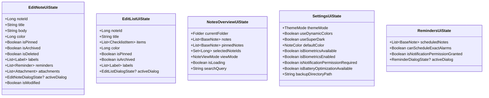

# Data Model & Presentation State Architecture

**Feature**: Unified Cross-Platform UI Composables (KMP)  
**Spec**: [spec.md](spec.md) | **Plan**: [plan.md](plan.md)

---

## 1. Core Presentation Entities & State Holders

All UI state entities are immutable data classes residing in `composeApp/src/commonMain/kotlin/com/philkes/notallyx/feature/`.



---

## 2. Detailed State Entity Definitions

### 2.1. Note & List Editor State (`feature/editor/`)

```kotlin
package com.philkes.notallyx.feature.editor

data class EditNoteUiState(
    val noteId: Long = 0L,
    val title: String = "",
    val body: String = "",
    val color: Long = BaseNote.COLOR_DEFAULT,
    val isPinned: Boolean = false,
    val isArchived: Boolean = false,
    val isDeleted: Boolean = false,
    val labels: List<Label> = emptyList(),
    val reminders: List<Reminder> = emptyList(),
    val attachments: List<Attachment> = emptyList(),
    val activeDialog: EditorDialogState? = null,
    val activeBottomSheet: EditorBottomSheetState? = null,
    val isModified: Boolean = false,
    val isTitleFocused: Boolean = false,
    val isBodyFocused: Boolean = false,
)

data class EditListUiState(
    val noteId: Long = 0L,
    val title: String = "",
    val items: List<ChecklistItem> = emptyList(),
    val color: Long = BaseNote.COLOR_DEFAULT,
    val isPinned: Boolean = false,
    val isArchived: Boolean = false,
    val isDeleted: Boolean = false,
    val labels: List<Label> = emptyList(),
    val reminders: List<Reminder> = emptyList(),
    val activeDialog: EditorDialogState? = null,
    val isModified: Boolean = false,
)
```

### 2.2. Settings State with Capability Flags (`feature/settings/`)

```kotlin
package com.philkes.notallyx.feature.settings

data class SettingsUiState(
    val themeMode: ThemeMode = ThemeMode.SYSTEM,
    val useDynamicColors: Boolean = false,
    val useSuperDark: Boolean = false,
    val defaultNoteColor: Long = BaseNote.COLOR_DEFAULT,
    val maxNoteLines: Int = 0,
    val viewMode: NoteViewMode = NoteViewMode.STAGGERED,
    // Platform Capability Flags
    val isBiometricsAvailable: Boolean = false,
    val isBiometricLockEnabled: Boolean = false,
    val isNotificationPermissionRequired: Boolean = false,
    val isBatteryOptimizationAvailable: Boolean = false,
    val backupLocation: String = "",
    val activeDialog: SettingsDialogState? = null,
)
```

### 2.3. Reminders State (`feature/reminder/`)

```kotlin
package com.philkes.notallyx.feature.reminder

data class RemindersUiState(
    val upcomingNotes: List<BaseNote> = emptyList(),
    val pastNotes: List<BaseNote> = emptyList(),
    val canScheduleExactAlarms: Boolean = true,
    val isNotificationPermissionGranted: Boolean = true,
    val activeDialog: ReminderDialogState? = null,
)
```

---

## 3. Source Set Allocation

```text
composeApp/
├── src/
│   ├── commonMain/kotlin/com/philkes/notallyx/
│   │   ├── core/ui/
│   │   │   ├── components/            # BaseNoteCard, LabelChip, ReminderChip, ColorChips
│   │   │   ├── dialog/                # ConfirmDialog, ColorPickerDialog, DatePicker
│   │   │   └── theme/                 # NotallyXTheme, Color, Type, Shape
│   │   ├── navigation/                # NotallyNavKey, NavDisplay, ListDetailScene, Navigator
│   │   └── feature/
│   │       ├── editor/
│   │       │   ├── EditNoteModel.kt
│   │       │   ├── EditNoteViewModel.kt
│   │       │   ├── EditListModel.kt
│   │       │   ├── EditListViewModel.kt
│   │       │   └── screens/
│   │       │       ├── EditNoteScreen.kt
│   │       │       ├── EditListScreen.kt
│   │       │       ├── EditTextPlainScreen.kt
│   │       │       └── EditorDialogs.kt
│   │       ├── main/
│   │       │   ├── MainModel.kt
│   │       │   ├── MainViewModel.kt
│   │       │   ├── PickNoteScreen.kt
│   │       │   └── routes/
│   │       │       ├── NotesGridScreen.kt
│   │       │       ├── NotesScreen.kt
│   │       │       ├── SearchScreen.kt
│   │       │       ├── ArchivedScreen.kt
│   │       │       └── DeletedScreen.kt
│   │       ├── labels/
│   │       │   ├── LabelsModel.kt
│   │       │   ├── LabelsViewModel.kt
│   │       │   ├── LabelsScreen.kt
│   │       │   └── SelectLabelsScreen.kt
│   │       ├── settings/
│   │       │   ├── SettingsModel.kt
│   │       │   ├── SettingsViewModel.kt
│   │       │   └── SettingsScreen.kt
│   │       ├── reminder/
│   │       │   ├── RemindersModel.kt
│   │       │   ├── RemindersViewModel.kt
│   │       │   ├── RemindersScreen.kt
│   │       │   └── NoteRemindersScreen.kt
│   │       └── media/
│   │           ├── PlayAudioScreen.kt
│   │           ├── RecordAudioScreen.kt
│   │           └── ViewImageScreen.kt
│   ├── androidMain/kotlin/com/philkes/notallyx/
│   │   └── feature/                   # Lean Android host routes & Activity result bridges
│   └── desktopMain/kotlin/com/philkes/notallyx/
│       └── core/ui/platform/          # DesktopFilePicker, DesktopShareHandler, DesktopPermissionChecker
```
